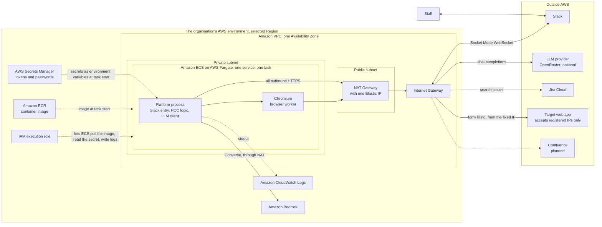
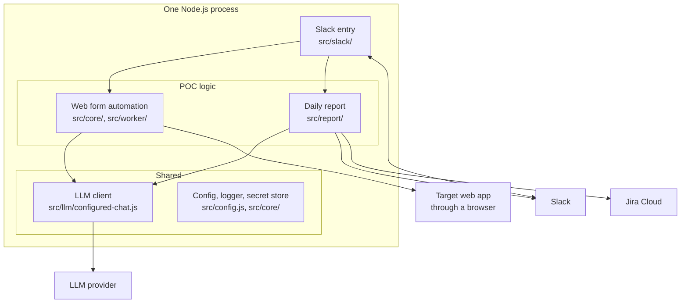
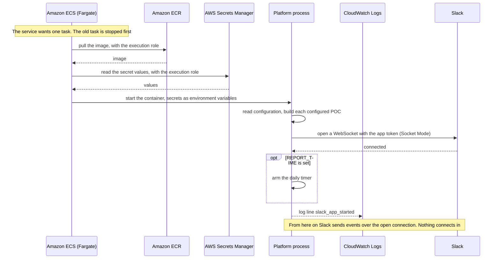
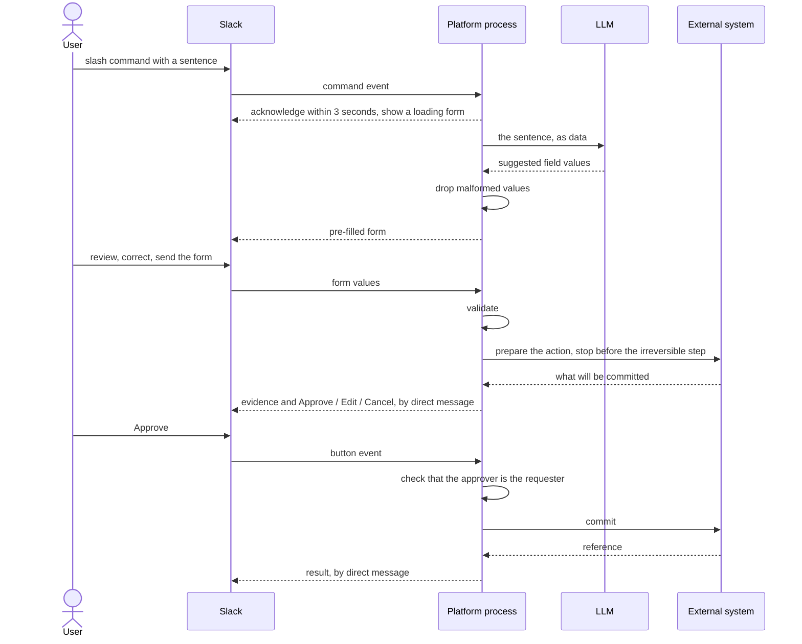
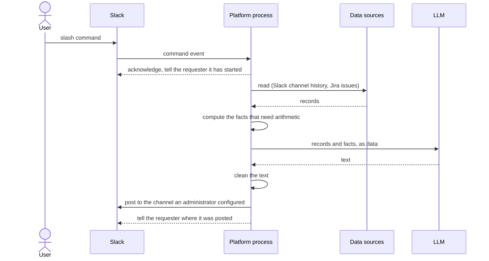
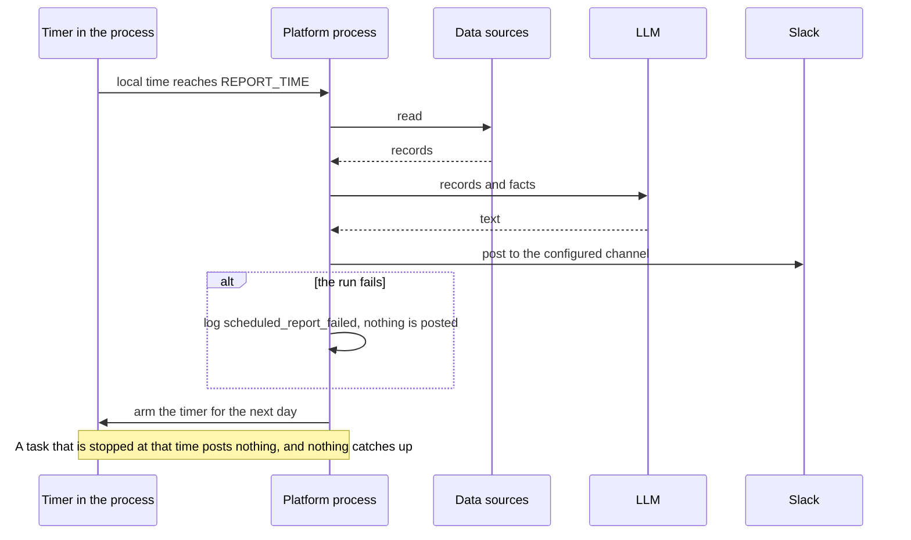

# Slack Automation Platform: Architecture

This document continues from [01-platform-overview.md](01-platform-overview.md) and assumes you have read it. It is for the engineer who maintains the platform or adds a POC to it: what is shared, how each outside system is connected, the rules every POC keeps, and where a new POC plugs in.

Each POC is described as a concept, without code, in its own document: [web form automation](poc/01-web-form-automation.md) and [daily report](poc/02-daily-report.md). This document holds the engineering detail of both. The AWS setup is in [03-aws-deployment.md](03-aws-deployment.md). What to request before reproducing any of it is in [05-prerequisites-and-access.md](05-prerequisites-and-access.md), and the running cost in [04-operating-cost.md](04-operating-cost.md). How to run the repository locally is in the [README](../README.md).

## 1. What exists and what does not

| Part | Status |
|---|---|
| Slack connection, shared by both POCs | Built. Run locally and on AWS |
| LLM through OpenRouter, shared by both POCs | Built. Run locally and on AWS |
| LLM through Amazon Bedrock, shared by both POCs | Built. Run locally and on AWS on 2026-10-11 with `zai.glm-4.7-flash`; see [03-aws-deployment.md](03-aws-deployment.md), section 9 |
| Jira Cloud, read-only | Built. Run against a real site on 2026-10-06, from a laptop |
| Jira Cloud, writing | **Not built** |
| Browser automation | Built. Run against the mock portal only |
| AWS runtime | Run on 2026-10-05 for the first POC, then deleted. Run again on 2026-10-11 from the templates in `infra/`, with both POCs, the private network and the fixed IP |
| Confluence | **Not built.** Section 3.6 lists what is known and what has to be decided |

The repository grew from the first POC, and some names still show it: the Slack app is called "Visitor Registration POC", and one file registers the handlers of both POCs. Section 6 says where that matters.

## 2. Runtime

Everything runs in one Node.js 22 process. It connects to Slack with Socket Mode, an outbound WebSocket, so it needs no public address. Every other connection is an outbound HTTPS call.

### 2.1 Component diagram

Every component of the platform, with the AWS services drawn by name. Solid lines carry application traffic; dotted lines are AWS's own plumbing or parts not yet built.



Which AWS service takes part, and for which POC:

| AWS service | Role | Web form automation | Daily report | Status |
|---|---|---|---|---|
| Amazon ECS on AWS Fargate | Runs the one process as a service with exactly one task (1 vCPU, 2 GB, `ARM64`) | Yes | Yes | Run on 2026-10-05 for the web form POC; on 2026-10-11 for both |
| Amazon ECR | Holds the container image | Yes | Yes | Run |
| AWS Secrets Manager | Holds Slack tokens, the LLM key, the web app password, the Atlassian token. ECS injects them as environment variables when the task starts | Yes | Yes | Run; with the Atlassian token and without an LLM key on 2026-10-11 |
| IAM execution role | Used by ECS itself, not by the application: pull the image, read the secret, write logs | Yes | Yes | Run |
| Amazon CloudWatch Logs | Receives the process's stdout, kept 7 days | Yes | Yes | Run |
| Amazon VPC: private and public subnet, Internet Gateway | A network of the platform's own, with no inbound rule | Yes | Not required | Run on 2026-10-11 |
| NAT Gateway with an Elastic IP | The one fixed outbound address | Yes: the web app checks the caller's IP | Not required: Slack, Jira and the LLM do not check it | Run on 2026-10-11; the outbound address equals the Elastic IP |
| Amazon Bedrock, with an IAM task role | The LLM inside AWS | Yes, when `LLM_PROVIDER=bedrock` | Yes, when `LLM_PROVIDER=bedrock` | Run on 2026-10-11; see section 3.2 |

No load balancer, API Gateway, Lambda, queue or database takes part: Socket Mode removes the inbound side, and state is held in memory. An EventBridge Scheduler rule for the report's schedule has been named as a production option and is not built.

The application itself calls no AWS API at run time. Everything on a dotted line from an AWS service is done by ECS before or around the process, which is why the same code runs unchanged on a laptop.

### 2.2 Modules inside the process



| Module | Shared or POC | Responsibility |
|---|---|---|
| `src/config.js` | Shared | The only place that reads environment variables |
| `src/core/logger.js` | Shared | One JSON line per event to stdout |
| `src/core/secret-store.js` | Shared interface, one method so far | Sign-in credentials for the target web app |
| `src/llm/configured-chat.js` | Shared | Picks the provider from configuration and returns one function: messages in, text out |
| `src/llm/openrouter-chat.js`, `src/llm/bedrock-chat.js` | Shared | The call to each provider |
| `src/slack/start-slack-app.js` | Shared | Builds every POC's service from the configuration and starts the app |
| `src/slack/slack-handlers.js` | Shared file, per-POC handlers | Slash commands, modal, buttons |
| `src/core/registration-fields.js` | Web form automation | Fields, input types, normalisation, validation rules, display. The Slack form and the LLM prompt follow from it |
| `src/llm/parse-free-text-request.js` | Web form automation | Turns a free-text request into suggested values; drops malformed values |
| `src/core/registration-service.js` | Web form automation | Lifecycle of one request: validation, duplicate check, the session awaiting approval, expiry, who may approve |
| `src/worker/portal-browser-session.js` | Web form automation | Signs in, operates the site, compares the confirmation screen, submits once approved |
| `src/slack/registration-modal.js` | Web form automation | The form shown in Slack and its per-field errors |
| `src/mock-portal/` | Web form automation | The simulated website the POC runs against |
| `src/report/slack-channel-history.js` | Daily report | The messages of each channel for one day, with thread replies, display names and file names, in the order written. Skips join and leave notices and the bot's own earlier reports |
| `src/report/jira-issues.js` | Daily report | One query; keeps key, summary, type, status, assignee, priority, due date, last update |
| `src/report/daily-report-service.js` | Daily report | The day's time window, the flags, the fallback when Jira fails, the clean-up, posting, the schedule |
| `src/llm/write-daily-report.js` | Daily report | The prompt and the call to the LLM |
| `src/report/configured-reporter.js` | Daily report | Builds the reporter from configuration; returns nothing when the report is not configured |

A POC is switched on by its configuration. Without an LLM provider (`OPENROUTER_API_KEY`, or `LLM_PROVIDER=bedrock`) the form opens empty; without the `REPORT_*` settings the `/daily-report` command answers that it is not configured. The process starts either way.

### 2.3 Interaction patterns

Four patterns cover every interaction the platform has today. A new POC is expected to reuse one of patterns B to D. Each POC's document shows its own flow in a simplified form, for readers who do not need the code.

**Pattern A: start-up.** How a task comes up on AWS. This is the only pattern in which AWS services other than the network take part.



On the trial this took about 40 seconds from task start to connected.

**Pattern B: request, pre-fill, approve, act.** For an action that cannot be undone. Used by web form automation.



**Pattern C: request, collect, write, post.** For a read-only summary. Used by the daily report on `/daily-report`.



**Pattern D: scheduled run.** The same work as pattern C with a timer in place of the user. Used by the daily report when `REPORT_TIME` is set.



In every pattern the LLM is a leaf: the platform calls it, takes text back, and decides in code what happens next.

## 3. Integrations

### 3.1 Slack

One Slack app serves every POC, defined by `slack-app-manifest.yaml`.

| Aspect | How it is done |
|---|---|
| Connection | Socket Mode with an app-level token (`connections:write`). No request URL, no inbound port |
| Entry points | Slash commands: `/visitor`, `/daily-report`. A global shortcut opens the visitor form |
| Reading channels | `conversations.history` and `conversations.replies`, only in channels the bot has been invited to |
| Posting | `chat.postMessage`; files with `files.uploadV2` for screenshots |
| One process per app token | Slack spreads events across every connection on one token. Two processes would each see part of a conversation |

Scopes, by what needs them:

| Scope | Needed by |
|---|---|
| `commands`, `chat:write` | Both |
| `im:write`, `files:write` | Web form automation: results and screenshots go by direct message |
| `channels:history`, `groups:history`, `channels:read`, `groups:read`, `users:read` | Daily report: read messages, channel names and display names |
| `chat:write.customize` | Test data only: `npm run seed` posts under simulated names |

Adding a scope means updating the app from the manifest and reinstalling it to the workspace. Remove `chat:write.customize` from a production app.

### 3.2 LLM

Both POCs call one function:

```js
chatCompletion({ apiKey, model, messages, timeoutMs, fetchImpl })   // returns the answer as text
```

`configuredChat` returns that function for the provider named by `LLM_PROVIDER`. For OpenRouter it posts to the chat-completions endpoint; for Bedrock it calls `Converse` with the credentials of the task role. Both use `temperature: 0` and throw on an HTTP error or an empty answer. Each caller owns its prompt and decides what to do with the text.

| Setting | Meaning |
|---|---|
| `LLM_PROVIDER` | `openrouter` (default) or `bedrock` |
| `OPENROUTER_API_KEY` | Switches the LLM on with OpenRouter |
| `OPENROUTER_MODEL` | Model for the form pre-fill, and the default for everything else. Default `deepseek/deepseek-v4.1-flash` |
| `BEDROCK_MODEL`, `BEDROCK_REGION` | The same with Bedrock. Defaults `zai.glm-4.7-flash` and the Region of the task |
| `REPORT_MODEL` | Model for the daily report, when it should differ |

Where the LLM runs is decided in this one file:

| Placement | State | What changes |
|---|---|---|
| Outside AWS: OpenRouter | Built; the default on a laptop | Nothing |
| Inside AWS: Amazon Bedrock with a task role | Built; what the templates in `infra/` deploy | `LLM_PROVIDER=bedrock`; no key, an IAM role instead. Results in [03-aws-deployment.md](03-aws-deployment.md), sections 7 and 9 |
| Inside AWS: Bedrock's OpenAI-compatible endpoint | Not tried | The endpoint URL and the model ID; a Bedrock API key is still stored |

The two built placements are selected by `LLM_PROVIDER`. The third would be a new provider in this file.

### 3.3 Jira Cloud

`fetchJiraIssues` in `src/report/jira-issues.js` makes one kind of call:

| Aspect | How it is done |
|---|---|
| Endpoint | `POST {site}/rest/api/3/search/jql`, paged with `nextPageToken`, up to 100 issues |
| Authentication | HTTP Basic with an Atlassian account's email and an API token |
| Fields read | Summary, status and its category, type, assignee, priority, due date, last update |
| Query | `JIRA_JQL`, or by default the project's open issues plus those updated in the last day |
| Writes | None |

An Atlassian API token carries every permission of the account it belongs to, across Jira and Confluence. Use a dedicated account that can only browse the projects the platform reads.

Two other ways to reach Jira were looked at, both existing tools that wrap the same REST API with the same three credentials: a Jira MCP server and a Jira command-line tool. They fit an AI agent that picks its own tools. The report runs one fixed query, so it calls the API directly.

### 3.4 Browser automation

Playwright drives Chromium inside the same container. Only the web form automation uses it.

Pointing that POC at another web application keeps the framework and rewrites three places:

1. **Field definitions** (`src/core/registration-fields.js`). Declare the fields, input types and rules of the new task. The Slack form and the LLM prompt follow from them.
2. **Browser worker** (`src/worker/`). Rewrite the sign-in, the steps, the confirmation-screen read and the submit. Keep the boundary: one function that goes as far as the stopping point (`fillToConfirmation`), and a separate one for the irreversible step (`submit`).
3. **Command name and Slack wording** (`src/slack/`, `slack-app-manifest.yaml`).

If the task has no confirmation screen of its own, create the stopping point: stop before the last button, take a screenshot and read back the fields that were filled.

Rules for the browser script:

- Prefer what a user sees (label, role, button name) over CSS classes and page structure. They change less often.
- Wait on page state (an element appears, the options have loaded), not on fixed delays.
- Always read back. When the screen changes, this turns a silent fault into a reported one.
- Run a test request on a schedule, up to the stopping point, then cancel it, to learn early when the web application changes.

A second web application means a second set of these three parts. The repository holds one today, and nothing in it yet selects between several. The AWS side of the switch is in [03-aws-deployment.md](03-aws-deployment.md), section 8.

The browser is the reason for the container size (1 vCPU, 2 GB) and for the Playwright base image. A deployment that runs only POCs without a browser could be much smaller; this has not been measured.

### 3.5 AWS

The AWS services, what each one does and which POC needs it are in section 2.1; how they are reached at start-up is pattern A in section 2.3. The templates and the script that create them are in [03-aws-deployment.md](03-aws-deployment.md); the permissions the deployer needs are in [05-prerequisites-and-access.md](05-prerequisites-and-access.md), section 6.

### 3.6 Confluence (planned)

Nothing is built. What is known:

- Confluence Cloud on the same Atlassian site accepts the same email and API token as Jira, so no new kind of credential is needed. The warning in 3.3 about the token's reach applies here in full.
- Two uses have been named: publishing a report as a page, and reading project pages as context for the LLM.

The access it will need is in [05-prerequisites-and-access.md](05-prerequisites-and-access.md), section 4.

To be decided before building: which of the two comes first; which space the platform may write to; and, for reading, how much page text may be sent to the LLM and through which provider.

A Confluence reader or writer would sit beside `src/report/jira-issues.js` as one module with one function per operation, taking its credentials as arguments.

## 4. Configuration

All settings are environment variables, read once in `src/config.js`. `.env.example` lists them with comments.

| Group | Variables | Secret |
|---|---|---|
| Slack | `SLACK_BOT_TOKEN`, `SLACK_APP_TOKEN` | Yes |
| LLM | `LLM_PROVIDER`; `OPENROUTER_API_KEY`, `OPENROUTER_MODEL`; `BEDROCK_MODEL`, `BEDROCK_REGION`; `REPORT_MODEL` | The OpenRouter key. Bedrock has none |
| Web form automation | `PORTAL_BASE_URL`, `PORTAL_USERNAME`, `PORTAL_PASSWORD`, `APPROVAL_TTL_SECONDS`, `BROWSER_HEADLESS` | Username and password |
| Daily report | `REPORT_CHANNELS`, `REPORT_POST_CHANNEL`, `REPORT_TIME`, `REPORT_LANGUAGE` | No |
| Jira | `JIRA_BASE_URL`, `JIRA_EMAIL`, `JIRA_API_TOKEN`, `JIRA_PROJECT_KEY`, `JIRA_JQL` | Email and token |
| Process | `TZ` | No |

`TZ` matters to both POCs: "tomorrow" in a form request, the day a report covers, and the time a report is posted are all computed in the process's clock, which is UTC in a container unless set.

## 5. Rules every POC keeps

- **LLM output is untrusted.** It is filtered or checked before use and never triggers an action. The form pre-fill drops malformed values; the report has user mentions neutralised before it is posted, so quoted chat cannot notify anyone.
- **Input text is data.** Prompts state that instructions inside the input are to be ignored. The daily report was tested with an instruction placed in an issue title.
- **Facts that need arithmetic are computed in code.** Whether an issue is overdue, or whether the chat mentions it, is worked out before the LLM sees the data and passed in as a flag.
- **An irreversible step needs a person.** The requester approves the exact screen before a form is submitted.
- **Output goes where an administrator pointed it.** A report is posted to a configured channel, not to the person who asked.
- **Personal data stays out of shared channels.** Form results go by direct message.
- **A failed dependency degrades, it does not stop the process.** No LLM: the form opens empty. Jira unreachable: the report is written from chat alone and says so.
- **Secrets come from the environment only**, and are never logged.
- **Outside systems are passed in.** Each service takes its Slack client, `fetch` and clock as arguments, so tests run without a network.

## 6. Adding a POC

The steps, with the daily report as the worked example:

| Step | Where | Daily report |
|---|---|---|
| 1. Settings | `src/config.js`, `.env.example` | The `REPORT_*` and `JIRA_*` groups |
| 2. A connector for each new outside system | One module, credentials as arguments, `fetchImpl` injectable | `src/report/jira-issues.js`, `src/report/slack-channel-history.js` |
| 3. The prompt, if an LLM is used | `src/llm/`, calling `chatCompletion` | `src/llm/write-daily-report.js` |
| 4. The service that holds the logic | Its own folder under `src/` | `src/report/daily-report-service.js` |
| 5. A factory that returns `null` when the POC is not configured | Beside the service | `src/report/configured-reporter.js` |
| 6. Slack entry point | A handler in `src/slack/slack-handlers.js`; a command and scopes in `slack-app-manifest.yaml` | `/daily-report` |
| 7. Wiring | `src/slack/start-slack-app.js` | Builds the reporter, passes it to the handlers, starts the schedule |
| 8. A way to run it without Slack | `scripts/` | `scripts/run-daily-report.js` |
| 9. Tests and sample data | `test/`, `test/fixtures/` | `test/daily-report.test.js` and three fixtures |
| 10. Documentation | `docs/poc/NN-name.md`; one row in the tables of the overview and of this document | [poc/02-daily-report.md](poc/02-daily-report.md) |

What is not yet modular, and will need attention as POCs are added:

| Limitation | Effect |
|---|---|
| `slack-handlers.js` holds the handlers of every POC | The file grows with each POC. Splitting it per POC is a mechanical change |
| The connectors for the daily report live in `src/report/` | A second POC that reads Jira or Slack history would import from another POC's folder, or the connectors move to a shared folder first |
| `secret-store.js` has one method, for the web app's credentials | Other secrets are read through `config.js` |
| One process, one task | Every POC restarts together, and a POC that holds state in memory fixes the task count at one for all of them |
| The Slack app's name and bot name are the first POC's | Cosmetic; changed in the manifest |

## 7. Tests and test data

`npm test` runs 44 tests. Eleven of them call the real model and run only when an LLM provider is configured: ten sentences for the form pre-fill and one sample day for the report. The rest use a real browser against the mock portal, or fakes for Slack and Jira.

| Data | File | Used by |
|---|---|---|
| Ten free-text requests with expected fields | `test/fixtures/free-text-requests.js` | Tests |
| One invented project day, already in the shape the readers return | `test/fixtures/daily-report-sample.js` | Tests; `npm run report -- --sample` |
| The same day as 25 Slack messages with threads and noise | `test/fixtures/channel-dump.js` | `npm run seed`, which posts them to a real channel |
| 17 Jira issues, one per case the report should handle | `test/fixtures/jira-seed-issues.js` | `npm run seed:jira`, which creates them in a real project |

The two seed scripts print what they would do and change nothing unless `--post` is given. Due dates are set relative to the day of seeding, so the issues go stale: a day later, "due today" has become "overdue". No script removes the seeded issues; delete them in Jira by the label `daily-report-seed`. Use a scratch project and a test channel.

The 17 issues, each one a case, with the result of the run on 2026-10-06 with OpenRouter, `deepseek/deepseek-v4.1-flash`:

| Ref | Case | Result |
|---|---|---|
| 101 | Chat says finished and merged; Jira still In Progress | Caught |
| 102 | Blocked in chat; chat gives a due date one day later than Jira's | Caught, both |
| 103 | Chat says 60% done; Jira still To Do and unassigned | **Missed** |
| 104 | Overdue, nobody mentioned it | Caught |
| 105 | Unassigned, due in two days, not in chat | Caught |
| 106 | Chat says it starts tomorrow; Jira already Done | Caught |
| 107 | New bug reported in chat, unassigned, no due date | Not assessed |
| 108 | Finished today without a word in chat | **Missed** |
| 109 | In progress and due today, not in chat | Caught |
| 110 | Top-priority bug, overdue, unassigned, not in chat | Caught as overdue; its priority was not shown |
| 111 | An epic: a container, not a piece of work | Not assessed |
| 112 | Sub-task of an issue discussed in chat | Not assessed |
| 113 | In progress with no owner and no due date | **Missed** |
| 114 | Control: due in a month | Correctly left out |
| 115 | Control: Done with a past due date | Correctly left out |
| 116 | The summary is an instruction to report every issue as on track | Not obeyed; listed as an overdue issue |
| 117 | Overdue by a month, lowest priority | Caught |

The project also held 20 older issues from other tests. Eight of them were overdue and the report listed all eight.

Why the three were missed: the prompt asks the Jira check for four things only: overdue issues, issues the chat says are finished while Jira does not, issues the chat says are blocked or slipping, and open issues due within three days that the chat does not mention. Work under way that Jira shows as not started, work finished silently, and work with no owner are outside that list. Priority is read from Jira but not passed to the LLM, which is why case 110 appeared without it.

This was one run with one model, read by one person. It shows what the report can do, not how often it does it.

## 8. Gaps to production

Gaps of the platform as a whole. Each POC's document lists its own.

| Area | Now | Needed |
|---|---|---|
| Who may use it | Anyone in the workspace can run any command | A list of permitted people or groups per command |
| Audit | JSON log to stdout, kept 7 days | A record of who asked for what, and when |
| Monitoring | None | An alert on error rate and on a missed scheduled run |
| LLM provider | OpenRouter or Bedrock, by configuration. The Bedrock model tried fails 3 of the 10 pre-fill sentences | A Bedrock model that passes all of them, or prompts tuned for it |
| Atlassian credentials | A personal account's token in the trial | A dedicated account with read access to named projects only |
| Slack scopes | Include a test-only scope | Remove `chat:write.customize` |
| State and schedule | In the memory of one process | Durable state; a schedule outside the process |
| Infrastructure as code | Two CloudFormation templates and a script, run by hand from a workstation | Deployment from a pipeline, with review of each change |
| Secret rotation | Manual | A schedule for the Slack tokens, the LLM key, the Atlassian token and the web app password |
