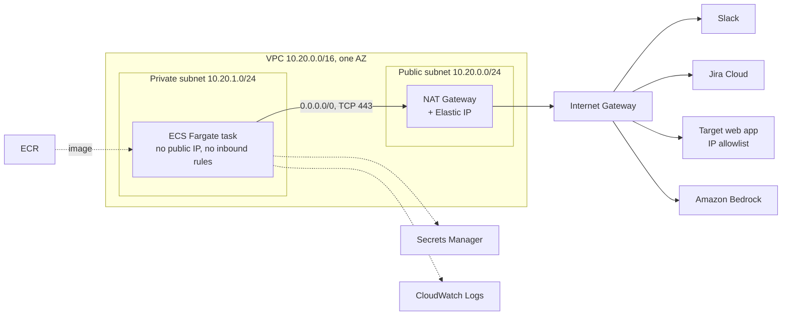

# AWS Deployment

This document is for the engineer who deploys the platform in their own AWS account. It covers what is created, the commands to create, verify, operate and remove it, the LLM on Amazon Bedrock, and what was measured when the authors ran it.

Read first: [05-prerequisites-and-access.md](05-prerequisites-and-access.md) lists every tool, service and permission to request before starting. What the platform is made of is in [02-platform-architecture.md](02-platform-architecture.md). What it costs to run is in [04-operating-cost.md](04-operating-cost.md).

One deployment serves every POC: they run in the same process, in the same task.

Names in angle brackets, such as `<region>`, are yours to fill in. Nothing in this repository refers to a particular AWS account, Slack workspace or Atlassian site.

## 1. What is created



Every connection the task makes leaves through the NAT Gateway, including the image pull, the secret read, the log writes and the calls to Bedrock. The task accepts no inbound connection: Slack is reached over an outbound WebSocket (Socket Mode).

| Setting | Reason |
|---|---|
| One AZ, one NAT Gateway | There is one task. A second AZ means a second NAT and **a second IP to register** with the web app's owner, without real added availability |
| Task count 1, `MinimumHealthyPercent` 0, `MaximumPercent` 100 | ECS stops the old task before starting the new one. Two copies would split Slack's events, and an approval could reach the copy that does not hold the job |
| Fargate 1 vCPU, 2 GB, `ARM64` | Sized for one browser. The image must be built for `linux/arm64`, which the script does |
| Two containers in the task: `portal` and `slack-app` | The mock portal runs beside the app and is reached on `localhost`, so the whole flow can be verified before a real web app is involved |
| Secrets injected as environment variables at task start | Only the execution role can read the secret. The application code reads plain environment variables |
| Task role with one statement | `bedrock:InvokeModel` on the one model in use. The application calls no other AWS service |
| Security group: no inbound rule, outbound TCP 443 only | Everything the platform talks to is HTTPS |
| No VPC endpoints | Each is billed hourly and costs more than the NAT traffic it saves at this size |
| Log retention 7 days | Enough for a POC; a parameter of the template |

## 2. Files

Everything is two CloudFormation stacks and one script. Every resource belongs to a stack and carries the tag `Project=<app>`, so the environment can be listed and removed completely.

| File | Content |
|---|---|
| `infra/base.yaml` | Stack `<app>-base`: the ECR repository and the Secrets Manager secret. Cheap to keep, slow to rebuild |
| `infra/platform.yaml` | Stack `<app>`: VPC, subnets, NAT Gateway, Elastic IP, security group, log group, two IAM roles, ECS cluster, task definition, service. Everything billed by the hour |
| `infra/profiles/*.env` | Resource profiles: the non-secret choices of one deployment (network, task size, model, time zone, report time) |
| `infra/poc.sh` | The life cycle commands in sections 4 to 6 |

`<app>` defaults to `slack-web-automation-poc`. Set the environment variable `APP` to another name to run a second, independent copy.

Secret values never go into a template, a parameter or a profile. The script reads them from your local `.env` and writes them to Secrets Manager through a temporary file readable only by the current user.

## 3. Profiles

| Profile | Network | Outbound IP | Use |
|---|---|---|---|
| `private-nat` (default) | Private subnet, NAT Gateway, Elastic IP | Fixed; printed as `outbound IP` by `status` | The target architecture. Required when the web app allowlists an address |
| `public` | Public subnet, task with a public IP, no NAT | Changes at every task start | The mock portal and the daily report, at less than half the cost |

A profile file holds:

| Key | Meaning |
|---|---|
| `NETWORK_PROFILE` | `private-nat` or `public` |
| `CPU`, `MEMORY` | Fargate task size, in CPU units and MiB |
| `BEDROCK_MODEL` | Model ID, which must be invocable in the deployment Region (section 7) |
| `TIME_ZONE` | The users' time zone, `UTC` in the two profiles; set your own in `infra/local.env`. "Tomorrow" in a request, the day a report covers and `REPORT_TIME` all use it |
| `REPORT_TIME` | Local `HH:MM` to post the daily report every day; empty to post only on `/daily-report` |

To make your own profile, copy one of the two files under another name and pass that name to `up`.

## 4. Deploy

Prerequisites are in [05-prerequisites-and-access.md](05-prerequisites-and-access.md). In short: AWS CLI v2 signed in, Docker running, Node.js, and a filled `.env`. Do **not** run `npm run slack` on a laptop with the same Slack app at the same time: two processes on one app token split the events.

```bash
cp infra/local.env.example infra/local.env   # set AWS_REGION, and AWS_PROFILE when you use a named CLI profile
infra/poc.sh up                              # or: infra/poc.sh up public
```

`infra/local.env` holds what belongs to your environment and not to the repository: the Region, the CLI profile, the time zone. Git ignores it, and its values override the profile's. Exporting the same variables in the shell works as well.

`up` does four things, each safe to repeat:

1. Creates the base stack.
2. Writes the secret from `.env`: `SLACK_BOT_TOKEN`, `SLACK_APP_TOKEN`, `PORTAL_USERNAME`, `PORTAL_PASSWORD`, and `JIRA_EMAIL`, `JIRA_API_TOKEN` when present.
3. Builds and pushes the image, only when the repository holds none.
4. Creates or updates the platform stack with the profile's values and the non-secret settings from `.env` (`REPORT_CHANNELS`, `REPORT_POST_CHANNEL`, `JIRA_BASE_URL`, `JIRA_PROJECT_KEY`).

The slow parts of a first `up` are the image push (about 1 GB compressed) and the NAT Gateway.

### 4.1 Verify

```bash
infra/poc.sh status                      # stacks, running task, outbound IP, every tagged resource
infra/poc.sh logs 30                     # the last 30 minutes of logs
infra/poc.sh verify                      # one-off task; today's report is printed, not posted
infra/poc.sh verify 2026-01-15 --post    # the report of that day, posted to the report channel
```

`verify` starts a second task from the same task definition with another command. It does not connect to Slack, so it does not disturb the running app. In one run it:

| Check | Passes when |
|---|---|
| Outbound IP | The line `OUTBOUND_IP …` equals `expected outbound IP` (profile `private-nat`). This also proves the private subnet can pull the image, read the secret and write logs through NAT |
| Web form flow | A sentence is pre-filled by the model, the form is filled in the mock portal, and a reference code is printed |
| Daily report | The report is printed, with a `llm_call` log line for the model |

The `portal` container of that task ends with exit code 137. That is ECS stopping it once the other container has finished.

Do the outbound IP check **before** giving the address to the web app's owner.

### 4.2 Check from Slack

The app log must show `slack_app_started` with `llmProvider`, `llmPrefill: true` and `dailyReport: true`. Then, in Slack:

| Action | Expected | Log events |
|---|---|---|
| `/visitor` followed by a sentence from `test/fixtures/free-text-requests.js` | A pre-filled form, then a screenshot with approve and cancel buttons, then a reference code | `llm_call`, `job_started`, `job_awaiting_approval`, `approval_requested`, `job_submitted` |
| The same request again | Refused as a duplicate | `prepare_failed` with `code: duplicate` |
| Cancel instead of approve | Nothing is submitted | `job_cancelled` |
| `/daily-report <YYYY-MM-DD>` | The report appears in the report channel; the requester only gets a pointer | `llm_call`, `daily_report_posted` |
| `REPORT_TIME` set a few minutes ahead in the profile, then `up` | The report of the day is posted at that minute | `daily_report_posted` |

Validation errors in the Slack form create no job and leave no log line.

## 5. Operate

| Task | Command | Notes |
|---|---|---|
| Deploy a new version of the code | `infra/poc.sh build` | Builds and pushes a new image tag, then replaces the task. Do it when no request is awaiting approval: the old task stops first and pending requests are lost |
| Change a setting or a secret value | Edit the profile or `.env`, then `infra/poc.sh up` | Secrets are read only when a task starts; `up` replaces the task |
| Stop the task | `infra/poc.sh pause` | Stops the Fargate charge only. The NAT Gateway and the Elastic IP stay, so the outbound IP is kept |
| Start it again | `infra/poc.sh resume` | |
| Read logs | `infra/poc.sh logs <minutes>` | |

The daily schedule lives in the process. A task that is stopped at `REPORT_TIME` posts nothing for that day, and nothing catches up afterwards. For a schedule that survives restarts, an EventBridge Scheduler rule that starts a one-off task running `node scripts/run-daily-report.js --post` is the AWS-native form; it has not been built.

## 6. Remove

| Command | Removes | Still billed | Outbound IP afterwards |
|---|---|---|---|
| `infra/poc.sh pause` | The running task | NAT Gateway, Elastic IP, secret, image | Kept |
| `infra/poc.sh down` | The platform stack: network, NAT, Elastic IP, roles, cluster, service, log group | Secret and image, well under 1 USD a month | **Released.** The next `up` gets a new address to register |
| `infra/poc.sh down --all` | Both stacks, the image, the secret without a recovery window, the task definition revisions | Nothing | Released |

`up` undoes `down` without rebuilding the image, and undoes `down --all` with a rebuild.

After `down --all`, `infra/poc.sh status` must print both stacks as `ABSENT` and an empty resource list. Two notes on that list:

- It comes from the tagging API, which keeps showing a deleted NAT Gateway and stopped tasks for about an hour. `aws ec2 describe-nat-gateways` shows their real state.
- Two resources live outside the stacks and the script removes them itself: old task definition revisions, and the secret's recovery window.

Afterwards, ask the web app's owner to remove the address from the allowlist, and revoke the Slack, Atlassian and web app credentials if they were created for the trial.

## 7. The LLM on Amazon Bedrock

The platform has two LLM providers behind one function, `configuredChat` in `src/llm/configured-chat.js`. `LLM_PROVIDER` picks one:

| `LLM_PROVIDER` | Code | Model setting | Credentials |
|---|---|---|---|
| `bedrock` (what the template sets) | `src/llm/bedrock-chat.js`, the Converse API | `BEDROCK_MODEL`, default `zai.glm-4.7-flash`; `BEDROCK_REGION`, default the task's Region | The AWS default chain: the task role on AWS, your CLI credentials on a laptop. No key to store or rotate |
| `openrouter` (the default on a laptop) | `src/llm/openrouter-chat.js` | `OPENROUTER_MODEL`, default `deepseek/deepseek-v4.1-flash` | `OPENROUTER_API_KEY` |

`REPORT_MODEL` sets a different model for the daily report with either provider. The template deploys the Bedrock form only; it does not pass an OpenRouter key to the task.

### 7.1 Check access before deploying

Model availability differs by Region, and a new AWS account may be refused by Bedrock altogether. One call tells:

```bash
aws bedrock list-foundation-models --region <region> --query 'modelSummaries[].modelId' --output text
aws bedrock-runtime converse --model-id <model-id> --region <region> \
  --messages '[{"role":"user","content":[{"text":"Say OK"}]}]' --inference-config '{"maxTokens":64}'
```

| Result | Meaning |
|---|---|
| An answer | The model can be used. Put its ID in the profile |
| `AccessDeniedException` | Your IAM identity lacks `bedrock:InvokeModel`, or the model's provider needs a one-time agreement or use-case form in the Bedrock console |
| `ValidationException: Operation not allowed`, or `Access to Bedrock models is not allowed for this account` | An account-level restriction. IAM cannot fix it; open a case with AWS Support. The authors met this on new accounts, and it was lifted later without any change on their side |
| `ValidationException` mentioning an inference profile | The model is offered only through a cross-Region inference profile. Use the profile ID, and widen the task role's policy to it, or pick a model served in-Region |

To use another model, change `BEDROCK_MODEL` in the profile and run `up`. The task role's policy follows the model ID.

### 7.2 What the two jobs send

| Job | Input | Output | Measured with `zai.glm-4.7-flash` |
|---|---|---|---|
| Web form pre-fill | One short sentence | A JSON object of about fifteen fields | About 510 input and 130 output tokens; 0.7 to 2.4 s |
| Daily report | One day of chat and the issue list, capped at 120,000 characters of chat | A report of eight sections | About 2,550 input and 670 output tokens for 25 messages and 34 issues; 3 to 10 s |

Two details of the Converse API matter to the code. `maxTokens` is always set (2,048 for the pre-fill, 4,096 for the report), because Bedrock otherwise reserves the model's maximum against the quota. And the answer is every text block joined, because a reasoning model returns a reasoning block before the text.

### 7.3 Choosing a model

The acceptance test is the 11 model tests in `npm test`: ten sentences for the pre-fill and one sample day for the report. Run it against a candidate before deploying it:

```bash
LLM_PROVIDER=bedrock BEDROCK_MODEL=<model-id> AWS_REGION=<region> npm test
```

| Provider and model | Pre-fill, 10 sentences | Report, sample day |
|---|---|---|
| OpenRouter, `deepseek/deepseek-v4.1-flash` | 10 pass | pass |
| Bedrock, `zai.glm-4.7-flash` | **7 pass, 3 fail** | pass |

The three failures were the same on every run: the visit date is one day off in a mixed-language sentence; the floor is missed in a sentence with an ISO date; a building that is not in the list is guessed where it should be left empty. None of them can reach the website unseen, because the requester reviews the form in Slack and approves a screenshot, but each is a wrong suggestion to correct. On a seeded day the report's Jira cross-check was also weaker than its other sections. The prompts were written for the other model and were not tuned. Treat the Bedrock default as proven to work, not as proven good enough.

## 8. Switching the web form POC to a real web app (not run)

Suggested order: deploy with the mock portal, confirm the outbound IP (4.1), register the address with the web app's owner, then switch. That keeps infrastructure faults apart from worker faults. The code changes are in [02-platform-architecture.md](02-platform-architecture.md), section 3.4; what to obtain from the web app's owner first is in [poc/01-web-form-automation.md](poc/01-web-form-automation.md), section 7.

On the AWS side:

1. Put the real account's `PORTAL_USERNAME` and `PORTAL_PASSWORD` in `.env`.
2. In `infra/platform.yaml`, remove the `portal` container and the `DependsOn` of `slack-app`, and set `PORTAL_BASE_URL` to the real address.
3. Run `infra/poc.sh up`.

## 9. Verification record

What the authors ran, so that a reader knows which parts are tested. All of it used the mock portal and invented chat and issue data.

| Part | Status |
|---|---|
| Profile `private-nat`: both stacks, both POCs in one task, Bedrock through the task role | Run |
| Fixed outbound IP | Confirmed: the address a task reports equals the Elastic IP. No real web app has checked it |
| `verify` | Run: outbound IP, form flow, report printed and posted |
| `/visitor` from Slack | Run: approved and submitted; the same request refused as a duplicate |
| `/daily-report <date>` from Slack | Run: posted to the report channel |
| Daily schedule | Run once: `REPORT_TIME` set a few minutes ahead, report posted in that minute. Not left running over several days |
| `build`, `pause`, `resume`, `down --all` | `build` and `down --all` run; `pause` and `resume` use the same code path as `up` and were not run on their own |
| Profile `public` | **Not run.** Same template with one parameter changed; passes `cfn-lint` |
| A real web app (section 8) | **Not run** |
| Recovery after a stopped task, expiry after 10 minutes, several requests awaiting approval at once | **Not tried** |

Measurements, one task of 1 vCPU and 2 GB:

| Check | Result |
|---|---|
| Task start to Slack connected | About 40 seconds |
| Sentence to pre-filled form | 1 to 2.5 seconds |
| Form sent to screenshot in Slack | About 4 seconds, with the mock portal on `localhost` |
| Peak memory and CPU over five requests in a row, one-minute data | About 10% of 2 GB, 7% of 1 vCPU |
| Time zone | "tomorrow" sent at 23:29 local time produced a reference dated the next local day |
| Secrets in the log | None found for the Slack and LLM key prefixes |

Latency against a real web app will depend mostly on that web app. The task size was left at 2 GB because nothing was measured with several browsers open.

## 10. Troubleshooting

| Symptom | Cause and fix |
|---|---|
| `up` fails and the platform stack is in `ROLLBACK_COMPLETE` | Read the first failed event: `aws cloudformation describe-stack-events --stack-name <app>`. Run `up` again after fixing; the script deletes the empty stack first |
| Image push fails midway | Network drop on a large layer. The script retries three times; run `infra/poc.sh build` again, pushed layers are kept |
| Task stops right after starting, `ResourceInitializationError` | The task cannot reach ECR or Secrets Manager. Check the NAT Gateway's state and the private route, or a key missing from the secret |
| App log shows `llmPrefill: false` or the model call fails | Bedrock access (7.1), or the model ID is not served in this Region |
| A slash command gets no answer, or events arrive only sometimes | No task is running, or a second process is connected with the same app token |
| The daily report fails to read or post to a channel | Invite the bot to every channel in `REPORT_CHANNELS` and to `REPORT_POST_CHANNEL` |
| Operations that worked start returning `AccessDenied` | A budget or spend control on the account may have paused it. Check with the account's owner |
| `status` lists a NAT Gateway after `down` | The tagging API lags (section 6) |
| Building on an x86 machine is very slow | The image is built for `linux/arm64` under emulation. Build on an ARM machine, or change the architecture in the template and the script together |
