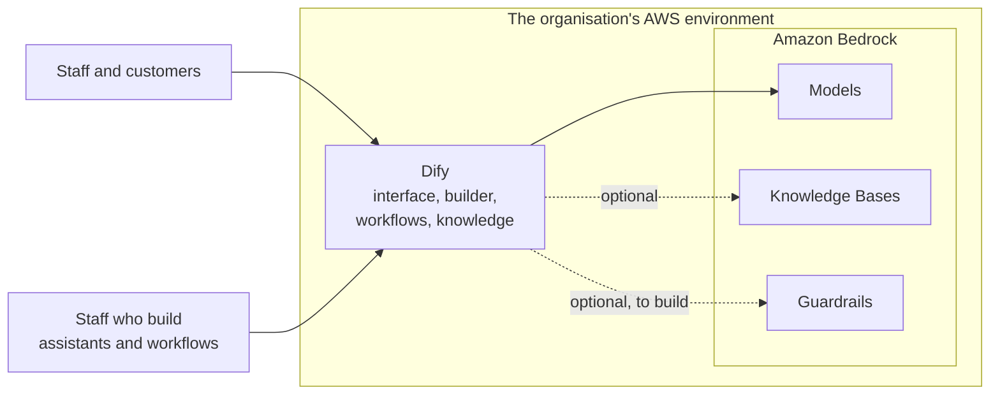

# Dify and Amazon Bedrock: A Basic Comparison

This document is for decision makers who have to choose what an internal AI platform is built on. It compares Dify and Amazon Bedrock at a basic level: what each one is, what each one gives for building a platform, and how each one fits with other AWS services.

It is a comparison from the two vendors' documentation, read in October 2026. In this repository only one part has been run: both POCs call an LLM on Amazon Bedrock. Dify, and the other parts of Bedrock named here, were not built or run. Products of this kind change quickly, so section 7 lists what to check again before deciding.

The same comparison for one concrete use case, a customer support bot in Slack and on web applications, is in [07-customer-support-bot-dify-vs-bedrock.md](07-customer-support-bot-dify-vs-bedrock.md).

## 1. Summary

Dify is not an AWS product. It is open-source software from the company LangGenius, and AWS is one of the places where it can be installed.

The two are not alternatives at the same level. **Bedrock is a set of parts** that engineers assemble through an API. **Dify is a finished product** with screens, in which people who do not write code build and use AI applications. They are often used together: Dify in front, with the LLM on Bedrock behind it.

| | Dify | Amazon Bedrock |
|---|---|---|
| What it is | A complete platform with its own interface | Building blocks: models, knowledge bases, agents, content filters |
| Made by | LangGenius, as open source | AWS |
| Who builds with it | Staff who do not write code, in a browser | Engineers |
| Who runs it | The organisation (self-hosted), or Dify (Dify Cloud) | AWS |
| Strongest at | Letting many teams build assistants and workflows quickly | Access control, audit, and little to operate, inside AWS |
| Main cost | A fixed monthly cost for the installation, plus the LLM | Pay for what is used |

What each one covers of what an AI platform needs:

| Layer | Dify | Amazon Bedrock |
|---|---|---|
| Interface for end users: chat page, widget in a website | Included | Not included: to build |
| Builder for people who do not write code | Included | A visual builder in the AWS console, for engineers |
| Workflows and agents | Included | Included (Flows, AgentCore) |
| Knowledge the LLM answers from | Included | Included (Knowledge Bases) |
| Content filters and masking of personal data | Basic | Included (Guardrails) |
| The LLMs themselves | Not included: uses a provider, which can be Bedrock | Included |

## 2. What each one is

### Dify

Dify is installed as a group of containers: about fifteen in its standard set-up, on a machine with at least 2 CPU cores and 4 GB of memory. It runs wherever containers run: on AWS, on another cloud or on the organisation's own servers. Dify also sells it as a hosted service, Dify Cloud.

What it gives:

- **Workflow and Chatflow.** A canvas on which a flow is drawn: call an LLM, branch, loop, call an API, run a small piece of code.
- **Agents.** The LLM chooses its own tools. Tools come from Dify's marketplace, from MCP servers or from the organisation's own APIs.
- **Knowledge base.** Documents are loaded, cut into passages and searched, so that the LLM answers from them.
- **Any model provider.** Amazon Bedrock is one of them, among many.
- **Triggers.** A workflow starts on a schedule, on a call from another system (webhook), or on an event from a connected product. An official Slack trigger exists.
- **A page and an API for every application.** What is built can be used at once in a browser, placed in a website or called by other software.
- **Logs and curated answers.** Each run is recorded. Staff can mark a good answer so that it is returned as written the next time the same question comes.

### Amazon Bedrock

Bedrock is a group of AWS services reached through an API and the AWS console. AWS runs them, and there is nothing to install.

- **Models.** LLMs from several makers behind one API, paid per use.
- **Knowledge Bases.** AWS loads, indexes and searches the organisation's documents. Connectors exist for file storage, SharePoint, Confluence, Google Drive, OneDrive and websites. Answers can carry citations.
- **Guardrails.** Filters for harmful content, forbidden topics and chosen words; blocking or masking of personal data; a check that an answer is supported by its sources.
- **AgentCore.** The parts for running agents: a managed agent loop, a place to run the team's own agent code, memory, a gateway that turns existing APIs into tools, identity, tracing and evaluation.
- **Flows.** A visual builder in the AWS console that links prompts, knowledge bases and other AWS services.

Bedrock has no interface for end users. Whatever people type into, a chat page, a Slack app or a widget, has to be built or brought.

The older agent service, now named Bedrock Agents Classic, accepts no new customers from 30 July 2026. New agents are built on AgentCore. Models, Knowledge Bases and Guardrails are not affected.

## 3. Building an AI platform

| Criterion | Dify | Amazon Bedrock |
|---|---|---|
| Who can build an application | Staff who do not write code, by dragging and dropping in a browser | Engineers. Flows is visual, but it sits in the AWS console and is not a place for business staff |
| Interface for end users | Ready: a chat page, a widget for websites, an API for each application | None. To build, or to connect to Slack as the POCs in this repository do |
| Workflows | Strong: branches, loops, API calls, code steps, triggers by schedule, webhook or event | Flows, which is simpler |
| Agents | Yes, with tools from the marketplace, MCP servers or the organisation's APIs | AgentCore. The older Bedrock Agents service is closed to new customers |
| Knowledge base | Included. The organisation runs the vector store with the rest of Dify | Run by AWS. Nothing to operate |
| Choice of models | Any provider, Bedrock included | Models offered on Bedrock. AgentCore can also call models from other providers |
| Users and permissions | Dify's own accounts, in one workspace. Single sign-on and several workspaces are in the paid Enterprise edition | AWS IAM, down to one model or one resource |
| Content filters, masking of personal data | Basic: a list of forbidden words, an outside moderation service, or a check the organisation writes itself | Guardrails |
| Operation | The organisation's: upgrades, backups, security patches | AWS's |
| Fixed cost | Yes. AWS's sample installation is estimated at about 50 USD per month, without the LLM | Close to none. Paid by use |
| Dependence on one supplier | Low. It can move to another cloud | High. It is tied to AWS |

## 4. Fit with other AWS services

### 4.1 What Dify needs, and the AWS service that can provide it

| Dify needs | AWS service | Fit |
|---|---|---|
| A place to run its containers | Amazon ECS on AWS Fargate, Amazon EKS, or one Amazon EC2 machine | Good. AWS's sample installation uses ECS on Fargate |
| A PostgreSQL database | Amazon RDS or Amazon Aurora | Good |
| Redis | Amazon ElastiCache | Good |
| File storage | Amazon S3 | Good. Supported by Dify itself |
| A vector store for the knowledge base | Amazon OpenSearch Service, or PostgreSQL with pgvector on Aurora | Good. A matter of configuration |
| LLMs and embedding models | Amazon Bedrock | Good. An official plugin exists. In AWS's sample the installation is given access by role, without an API key |
| A knowledge base that already exists on AWS | Bedrock Knowledge Bases | Possible, not directly. A plugin verified by Dify, or the connecting component in AWS's sample, presents it to Dify as an outside knowledge base |
| Content checks beyond Dify's own | Bedrock Guardrails | To build. Dify can send questions and answers to a check the organisation writes, and that check could call Guardrails. Not verified |
| Email to invite members | Amazon SES | Possible |
| Passwords and keys | AWS Secrets Manager | Possible. This belongs to the installation, not to Dify |

### 4.2 Integration compared

| Area | Dify | Amazon Bedrock |
|---|---|---|
| Permissions through AWS IAM | Only for the installation: which models its containers may call. People who use Dify do not pass through IAM | Built in, for everything |
| Audit trail (AWS CloudTrail) | Records the calls Dify makes to AWS. Who did what inside Dify stays inside Dify | Every call is recorded |
| Monitoring (Amazon CloudWatch) | Container logs. The detail of each run is in Dify's own screens | Metrics and logs built in |
| Storage and databases | Uses S3, Aurora, ElastiCache and OpenSearch underneath | Knowledge Bases read from S3 and the other connected sources |
| Calling AWS Lambda, AWS Step Functions and the other AI services | Through a plugin or an API call step | Direct |
| Creation by template (AWS CloudFormation) | The installation only. The applications built in Dify live in Dify's database | Most resources can be created by template |
| Private networking (AWS PrivateLink) | To design | Available |
| Support in an incident | AWS supports the infrastructure. Dify itself relies on the community, or on a paid edition | AWS supports all of it |

## 5. Editions, licence and cost

| Dify edition | Where it runs | Price | What matters |
|---|---|---|---|
| Community | Self-hosted | Free | One workspace. No single sign-on. No support contract |
| Enterprise | Self-hosted | By quotation | Several workspaces, single sign-on, a commercial licence, support with an agreed service level |
| Cloud: Sandbox | At Dify | Free | A trial: 1 member, 5 applications |
| Cloud: Professional | At Dify | 590 USD per workspace per year | 3 members, 50 applications |
| Cloud: Team | At Dify | 1,590 USD per workspace per year | 50 members, 200 applications |

Dify has also offered a Premium edition as a machine image on AWS Marketplace, with the organisation's own logo. Confirm that it is still listed, and that the AWS account is allowed to subscribe to Marketplace products.

**Dify's licence** is based on Apache 2.0 with two added conditions that matter here:

- The source code may not be used to run a multi-tenant service without Dify's written agreement. This applies when one installation serves several separate organisations.
- The Dify logo and copyright notice may not be removed or changed in the console or in the applications. This applies to a chat widget shown to customers.

**Bedrock** has no licence and no fixed fee. Models are paid by the amount of text, and AgentCore by consumption. For the size of the bills seen in this repository's POCs, see [04-operating-cost.md](04-operating-cost.md).

**Running Dify on AWS** has a fixed cost whether or not anyone uses it. AWS's sample installation gives about 50 USD per month for its cheaper configuration at the list prices of one Region, without the LLM. This figure was not measured here.

## 6. Which to choose

| The goal | Fits better | Why |
|---|---|---|
| Many departments build their own assistants and workflows | Dify | Bedrock has no front for people who do not write code |
| The engineering team builds a few fixed applications, with tight control of access and data | Amazon Bedrock | Permissions and audit are built in, and there is less to operate |
| Staff need a quick front, and the organisation's text must stay inside AWS | Both | Dify runs on AWS and calls models on Bedrock |
| The organisation may leave AWS later, or uses several clouds | Dify | It does not depend on one cloud |
| No team is available to operate a platform | Amazon Bedrock, or Dify Cloud | A self-hosted Dify needs upgrades, backups and patches |

## 7. What to check before deciding

1. **Models in the Region.** Which models Bedrock offers in the Region the organisation uses, and whether AgentCore and Knowledge Bases are available there.
2. **Single sign-on.** If staff must sign in with the organisation's own accounts, Dify needs the Enterprise edition.
3. **AWS Marketplace.** Whether the AWS account may subscribe to Marketplace products, if a paid Dify edition is to be bought there.
4. **The licence.** Whether the planned use counts as multi-tenant, and whether the Dify logo may appear in front of customers.
5. **Who operates Dify.** A named team for upgrades, backups and incidents.
6. **Where the text goes.** With Dify Cloud it is held at Dify. With a self-hosted Dify it stays in the organisation's environment, and goes on to whichever model provider is configured.
7. **The current state of both products.** Read the sources below again: the facts here are from October 2026.

## 8. Sources

- [Dify on GitHub](https://github.com/langgenius/dify), and its [licence](https://github.com/langgenius/dify/blob/main/LICENSE)
- [Dify: self-hosting with Docker Compose](https://docs.dify.ai/en/self-host/quick-start/docker-compose)
- [Dify: pricing](https://dify.ai/pricing)
- [Dify: which trigger to use](https://www.dify.ai/blog/which-trigger-should-i-use-a-beginner-s-guide-to-starting-dify-workflows)
- [Dify: annotation reply](https://docs.dify.ai/en/use-dify/monitor/annotation-reply)
- [Dify: moderation API extension](https://docs.dify.ai/en/use-dify/workspace/api-extension/moderation-api-extension)
- [Dify: AWS Bedrock Knowledge Base plugin](https://marketplace.dify.ai/plugin/langgenius/aws_bedrock_knowledge_base)
- [AWS sample: Dify self-hosted on AWS](https://github.com/aws-samples/dify-self-hosted-on-aws)
- [Amazon Bedrock Knowledge Bases](https://docs.aws.amazon.com/bedrock/latest/userguide/knowledge-base.html)
- [Amazon Bedrock Guardrails](https://docs.aws.amazon.com/bedrock/latest/userguide/guardrails.html)
- [Amazon Bedrock Flows](https://docs.aws.amazon.com/bedrock/latest/userguide/flows.html)
- [Amazon Bedrock AgentCore](https://docs.aws.amazon.com/bedrock-agentcore/latest/devguide/what-is-bedrock-agentcore.html)
- [Amazon Bedrock Agents Classic maintenance mode](https://docs.aws.amazon.com/bedrock/latest/userguide/agents-classic-maintenance-mode.html)
