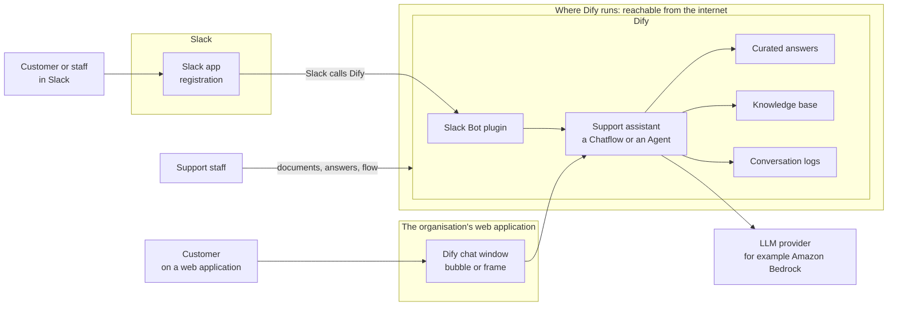
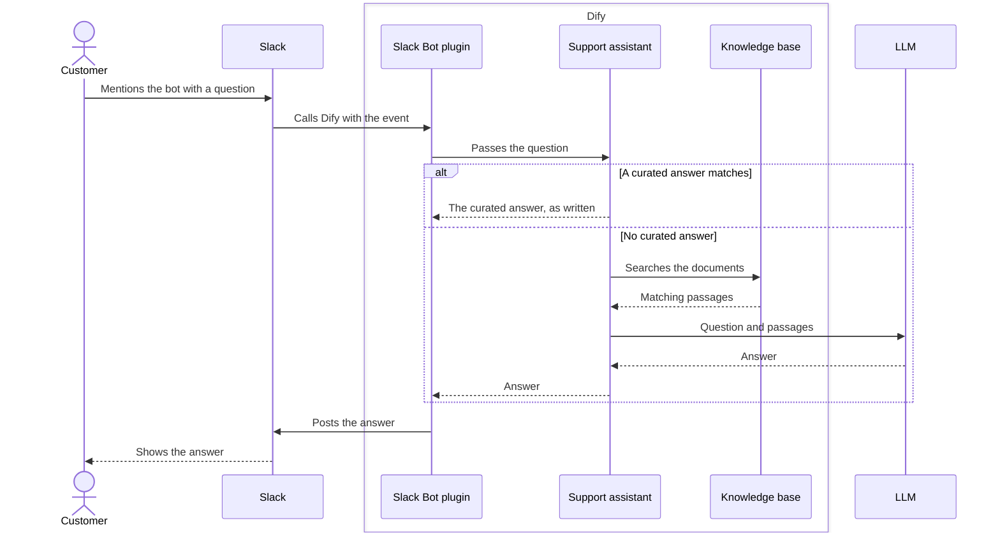
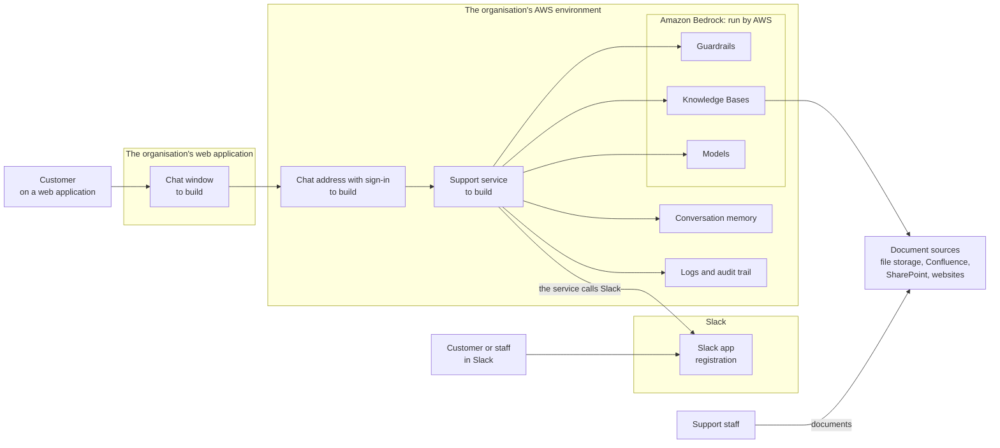
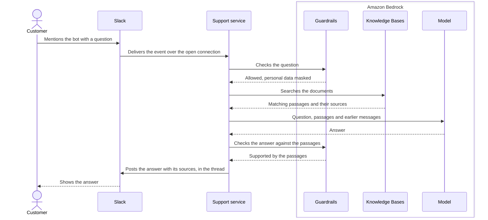

# A Customer Support Bot in Slack and on Web Applications: Dify or Amazon Bedrock

This document is for decision makers. It takes one use case, a customer support bot in Slack and on web applications, and describes it twice: built with Dify, and built with Amazon Bedrock. Each case has a component diagram and a flow diagram, and section 5 compares the two.

Nothing in this document was built or run in this repository. It is a design comparison from the two vendors' documentation, read in October 2026. What this repository did verify is narrower: a program that opens the connection to Slack, and LLM calls to Amazon Bedrock. Both POCs use them, and Case B draws on them. Section 8 lists what a POC of either case has to verify.

The general comparison of the two products is in [06-dify-and-bedrock.md](06-dify-and-bedrock.md).

## 1. Summary

The bot answers questions from the organisation's support documents, in Slack and in a chat window on web applications, and passes the conversation to a person when it cannot answer.

- **With Dify, most of the bot is ready-made.** The Slack connection, the chat window for web pages, the knowledge base and a screen where support staff correct answers all exist. The work is configuration, plus running Dify.
- **With Bedrock, the parts behind the bot are ready-made and run by AWS:** document search, content filters and the models. The front is to build: the program that talks to Slack, the chat window, sign-in, and a screen for support staff.
- **They combine.** Dify can be the front, with the models on Bedrock behind it.

| | Case A: Dify | Case B: Amazon Bedrock |
|---|---|---|
| Ready-made | Slack connection, chat window, knowledge base, curated answers, conversation logs | Document search, content filters, masking of personal data, models, audit trail |
| To build | Little. Mostly configuration | The Slack program, the web chat and its sign-in, the screen for support staff |
| Who changes how the bot behaves | Support staff, in a browser | Engineers |
| What the organisation operates | A Dify installation, about fifteen containers and their data | One small service |
| Main points to watch | Slack must reach Dify from the internet. Behaviour in Slack threads. The Dify logo in front of customers | Engineering time. No tool for support staff until one is built |

## 2. The use case, and what any solution needs

Customers, or the staff who serve them, ask questions in two places:

- **Slack:** a channel of the workspace, for example one shared with a customer organisation.
- **Web applications:** a chat window inside the organisation's own website or product.

Whatever the bot is built with, it needs the same blocks.

| Block | What it does |
|---|---|
| Slack channel | Receives a question in Slack and posts the answer in the same thread |
| Web channel | A chat window inside a web application |
| Knowing who asks | On the web, which customer is typing. It decides what the bot may tell them |
| Conversation memory | A follow-up question is understood with the messages before it |
| Knowledge | The support documents, searched for the passages that answer the question |
| LLM | Writes the answer from those passages |
| Safeguards | Filters for harmful content, masking of personal data, a check that the answer is supported by the documents |
| Handover to a person | When the bot cannot answer, a member of the support staff takes over |
| Content upkeep | Someone keeps the documents current and corrects wrong answers |
| Logs and measurement | What was asked, what was answered, how often the bot failed |
| Operation | Someone keeps the system running, patched and backed up |

## 3. Case A: built with Dify

### 3.1 The components

Everything inside the Dify box comes with the product. The support assistant is drawn by staff on Dify's canvas and is not programmed.

### 3.2 The flow

On a web application the customer types into the Dify chat window, which talks to the support assistant directly. The rest of the flow is the same.

### 3.3 What is ready and what is to do

| Block | With Dify |
|---|---|
| Slack channel | Ready. The official Slack Bot plugin links a Slack app to a Dify application, and the bot answers when it is mentioned. Its page does not say whether it answers inside the thread or remembers earlier messages: to verify. A community plugin adds answers in threads |
| Web channel | Ready. The assistant's chat page is placed in a web page as a floating bubble or as a frame, with the organisation's colours. A custom chat window can also be built on the assistant's API |
| Knowing who asks | To design. The web page can pass a customer's identifier and name to the chat window, but Dify's guide describes no sign-in for it |
| Conversation memory | Ready in the chat window. In Slack: to verify |
| Knowledge | Ready. Documents are uploaded in the browser, or an outside knowledge base is connected |
| LLM | Configured, from any provider. Amazon Bedrock is one |
| Safeguards | Basic: a list of forbidden words, an outside moderation service, or a check the organisation writes itself. Applied to questions and to answers |
| Handover to a person | To design. Dify has a step that pauses a flow and asks a person by email or by web form. Passing a live conversation to support staff in Slack is not ready-made |
| Content upkeep | Ready. Support staff read the conversations and mark the correct answer to a question. The next time that question comes, the marked answer is returned as written |
| Logs and measurement | Ready, in Dify's screens |
| Operation | The organisation's: about fifteen containers, a database and a document index, with upgrades, backups and security patches. Or Dify Cloud, where Dify operates it and holds the text |

### 3.4 Points to know

- **Slack has to reach Dify.** In this design Slack calls an address that Dify generates, and customers' browsers load the chat window from Dify. The installation therefore has an address open to the internet. The same installation holds the screens where assistants are built, so what is exposed has to be designed.
- **Slack waits 3 seconds.** Slack expects each event to be acknowledged within 3 seconds and sends it again if it is not. An LLM answer often takes longer. The plugin has a setting about these repeats, and its page recommends the value that prevents duplicate messages. To verify with slow answers.
- **The sample is simple.** Dify's own walkthrough for building such a plugin answers each mention by itself, with no memory of the conversation, and posts the error text in the channel when something fails. Whether the official plugin behaves in the same way is to verify before customers see it.
- **The logo stays.** Dify's licence does not allow its logo and copyright notice to be removed from its applications. A chat window shown to customers carries them, unless a paid edition or a custom-built window is used. To confirm with Dify.
- **One installation, one organisation.** The licence does not allow one installation to serve several separate organisations without Dify's written agreement. This matters if the bot is offered to customers as a service of their own.
- **Accounts.** The free edition has one workspace and its own user accounts. Signing in with the organisation's accounts is in the paid Enterprise edition.

## 4. Case B: built with Amazon Bedrock

### 4.1 The components

The support service is a program the team writes. In Slack it works as the two POCs of this repository do: the service opens the connection to Slack and keeps it open, so nothing on the internet can call it. Only the web channel needs an address open to the internet.

### 4.2 The flow

On a web application the question arrives from the chat window through the chat address, after sign-in. The rest of the flow is the same. When a check fails, the service posts a fixed message or hands over to a person.

### 4.3 What is ready and what is to do

| Block | With Amazon Bedrock |
|---|---|
| Slack channel | To build. Bedrock has no connection to Slack. Two known designs: a service that opens the connection to Slack, as in this repository, or AWS's published design, in which Slack calls a public address on AWS and a queue with three small functions passes the question on |
| Web channel | To build: the chat window, and the address it calls |
| Knowing who asks | To build, with full control: the chat address can require the organisation's own sign-in |
| Conversation memory | To assemble. AgentCore has a memory service. In Slack the service can also read the thread again |
| Knowledge | Ready, run by AWS. Knowledge Bases load and search documents from file storage, Confluence, SharePoint, Google Drive, OneDrive and websites, return the sources with each passage, and can limit results to the documents a person may see |
| LLM | Ready. Models from several makers, paid by use |
| Safeguards | Ready. Guardrails filter harmful content and forbidden topics, block or mask personal data, and check that an answer is supported by its sources |
| Handover to a person | To build |
| Content upkeep | Documents: ready, by updating the connected sources. A screen where support staff read conversations and correct answers: to build |
| Logs and measurement | Ready for engineers: logs, metrics, an audit trail of every call, and tracing and evaluation of agents in AgentCore. A view for support staff: to build |
| Operation | One small service. AWS runs the rest |

### 4.4 Points to know

- **This is an engineering project.** Every change to how the bot behaves goes through engineers, until a tool for support staff is built.
- **Follow the current examples.** AWS's older examples for Slack use the earlier agent service, now named Bedrock Agents Classic, which accepts no new customers from 30 July 2026. The current example uses AgentCore.
- **Access is tight by default.** The service is allowed to call one model, one knowledge base and one guardrail. Every call is recorded in the audit trail.
- **Masking has a limit.** Guardrails mask personal data in the answer. The original text can still reach the logs, so the logs need their own protection.
- **Availability differs by Region.** Models, Knowledge Bases and AgentCore are not offered in every Region: to check for the Region in use.

## 5. Side by side

| Criterion | Case A: Dify | Case B: Amazon Bedrock |
|---|---|---|
| Slack channel | Ready (plugin). Thread and memory behaviour to verify | To build. The pattern is verified in this repository for other use cases |
| Web channel | Ready: bubble or frame | To build |
| Address open to the internet | Needed for Slack and for the web | Needed for the web only |
| Knowing who asks, on the web | To design. No sign-in in the chat window | To build, with the organisation's sign-in |
| Knowledge | Ready. The organisation operates the index | Ready. AWS operates it |
| Answers from approved text | Ready: curated answers | To build |
| Content filters, personal data | Basic | Guardrails |
| Handover to a person | To design | To build |
| Who changes how the bot behaves | Support staff, in a browser | Engineers |
| Time to a first working bot | Short: installation and configuration | Longer: a program to write |
| Operation | The organisation's: a full installation | One small service |
| Fixed cost on AWS, without the LLM | About 50 USD per month in AWS's sample installation | About 39 USD per month for an always-on service of the size used in this repository, plus the web channel |
| Cost that grows with use | The LLM | The LLM, document search and content checks |
| Licence | The logo stays. No multi-tenant use without agreement | None |
| Dependence on one supplier | Low. Dify runs on any cloud | High. Tied to AWS |

Neither figure was measured for this use case. The first is AWS's own estimate for its sample installation of Dify. The second comes from [04-operating-cost.md](04-operating-cost.md). Document search and content checks on Bedrock were not estimated.

## 6. Combining the two

The two cases are not exclusive. Dify can be the front and Bedrock the back.

| Part | Provided by | State |
|---|---|---|
| Slack connection, chat window, flow, curated answers, staff screens | Dify | As in Case A |
| Models | Amazon Bedrock | An official plugin. In AWS's sample installation Dify is given access by role, with no API key |
| Document search | Dify's knowledge base, or Bedrock Knowledge Bases | A plugin verified by Dify presents a Bedrock knowledge base to Dify as an outside knowledge base. It asks for an AWS access key, and its address has no authorisation of its own: to review before use |
| Content checks | Dify's own, or Bedrock Guardrails | To build. Dify can send questions and answers to a check the organisation writes, and that check could call Guardrails. Not verified |

With this combination the organisation's text stays inside its own AWS environment, and support staff keep a tool they can use without engineers. The operation of Dify, and the licence points of Case A, remain.

## 7. Which fits when

| Situation | Fits better | Why |
|---|---|---|
| A team in the organisation already runs Dify and has support bots in Slack | Dify, extended to the web | The installation, the skills and the content are there. The chat window is a matter of configuration |
| Support staff must change answers themselves, every week | Dify | Bedrock has no screen for them |
| A first bot is wanted quickly, to learn what customers ask | Dify | Little to build |
| The bot may show a customer only that customer's own data | Amazon Bedrock | Sign-in and permissions are designed in from the start |
| Strict rules on personal data and audit | Amazon Bedrock, or the combination | Guardrails and the audit trail are built in |
| No team is available to operate a platform | Amazon Bedrock, or Dify Cloud | A self-hosted Dify needs upgrades, backups and patches |
| The bot is to be sold to several customer organisations | Amazon Bedrock, or Dify with a commercial licence | Dify's free licence does not allow multi-tenant use |
| The engineering team already runs services of this kind on AWS | Amazon Bedrock | The Slack pattern and the environment already exist |

For an organisation that already runs Dify, the questions to put to the team that operates it are:

1. Which edition is in use, and does its licence cover a chat window shown to customers?
2. How does Slack reach the installation, and what else is open at that address?
3. Does the bot answer in threads and remember earlier messages, and with which plugin?
4. Which LLM provider does it use, and so where does customers' text go?
5. Who upgrades it, backs it up and answers when it stops?

## 8. What to verify in a POC

**Either case**

1. The bot answers a set of real support questions from real documents, and the share of correct answers is measured.
2. A follow-up question in the same Slack thread is understood.
3. A question outside the documents gets "I do not know" and a handover, not an invented answer.
4. A message containing personal data is handled as the organisation's rules require.
5. One customer cannot see another customer's information.

**Case A, Dify**

6. The Slack plugin: threads, memory, and no duplicate or lost answers when the LLM is slow.
7. What is reachable at the installation's public address.
8. The chat window on the real website, including the site's own security rules, which can block a frame from another address.
9. The licence, for the planned use.
10. An upgrade and a restore from backup, done once.

**Case B, Amazon Bedrock**

11. The models, Knowledge Bases and AgentCore are available in the Region in use.
12. Document search over the real sources, with the documents' own permissions.
13. Guardrails set for the organisation's language and topics.
14. The web chat window and its sign-in.
15. The time engineers need for a change that support staff ask for.

## 9. Sources

- [Dify: Slack Bot plugin](https://marketplace.dify.ai/plugin/langgenius/slack-bot), [Slack Trigger plugin](https://marketplace.dify.ai/plugins/langgenius/slack_trigger), and a [community Slack plugin with thread replies](https://marketplace.dify.ai/plugin/takada-at/slack-bot2)
- [Dify: developing a Slack bot plugin](https://docs.dify.ai/en/develop-plugin/dev-guides-and-walkthroughs/develop-a-slack-bot-plugin)
- [Dify: embedding in websites](https://docs.dify.ai/en/use-dify/publish/webapp/embedding-in-websites)
- [Dify: knowledge](https://docs.dify.ai/en/use-dify/knowledge/readme)
- [Dify: annotation reply](https://docs.dify.ai/en/use-dify/monitor/annotation-reply)
- [Dify: moderation API extension](https://docs.dify.ai/en/use-dify/workspace/api-extension/moderation-api-extension)
- [Dify: Human Input node](https://docs.dify.ai/en/use-dify/nodes/human-input)
- [Dify: AWS Bedrock Knowledge Base plugin](https://marketplace.dify.ai/plugin/langgenius/aws_bedrock_knowledge_base)
- [Dify: licence](https://github.com/langgenius/dify/blob/main/LICENSE) and [pricing](https://dify.ai/pricing)
- [AWS sample: Dify self-hosted on AWS](https://github.com/aws-samples/dify-self-hosted-on-aws)
- [AWS: integrating Amazon Bedrock AgentCore with Slack](https://aws.amazon.com/blogs/machine-learning/integrating-amazon-bedrock-agentcore-with-slack/)
- [AWS: integrate Amazon Bedrock Agents with Slack](https://aws.amazon.com/blogs/machine-learning/integrate-amazon-bedrock-agents-with-slack) (the earlier agent service)
- [AWS: a generative AI assistant with Slack and Amazon Bedrock](https://aws.amazon.com/blogs/machine-learning/create-a-generative-ai-assistant-with-slack-and-amazon-bedrock/)
- [Amazon Bedrock Knowledge Bases](https://docs.aws.amazon.com/bedrock/latest/userguide/knowledge-base.html)
- [Amazon Bedrock Guardrails](https://docs.aws.amazon.com/bedrock/latest/userguide/guardrails.html)
- [Amazon Bedrock AgentCore](https://docs.aws.amazon.com/bedrock-agentcore/latest/devguide/what-is-bedrock-agentcore.html)
- [Amazon Bedrock Agents Classic maintenance mode](https://docs.aws.amazon.com/bedrock/latest/userguide/agents-classic-maintenance-mode.html)
