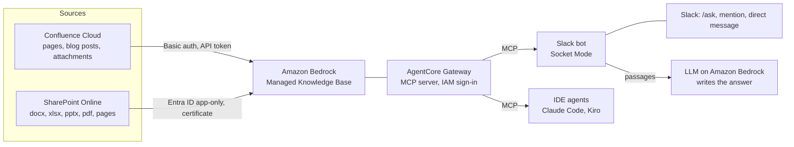

# Knowledge Base Chatbot: Slack, Confluence, SharePoint and an MCP Server

This document is for the engineer who sets up the knowledge base chatbot in their own AWS project, Slack workspace, Confluence site and Microsoft 365 tenant. It lists what to prepare, the commands to run, and how to check the result.

Status: the code, the sample documents and the tests in this repository are written and the tests pass on a laptop. The AWS part (`infra/kb.sh up`, `sync`, `ask`) and `npm run kb:check` have been run with both sources: the sample SharePoint library and the sample Confluence space synced without failures, and the gateway returned the expected passage for all 28 test questions. The Slack bot answered live questions by command, mention and direct message. The IDE proxy has not been run yet, so treat that part as a procedure to verify.

For the concept and its results, see [poc/03-knowledge-base-chatbot.md](poc/03-knowledge-base-chatbot.md). For an introduction to the service, see [09-bedrock-managed-knowledge-base.md](09-bedrock-managed-knowledge-base.md).

## 1. What it is

One knowledge base, two ways in.



- The knowledge base reads both sources on a schedule (daily by default) or on demand. Bedrock stores, parses, chunks and indexes the content; there is no vector database to run.
- The gateway publishes the knowledge base as an MCP server with two tools: `managed-kb___Retrieve` (returns passages) and `managed-kb___AgenticRetrieveStream` (plans several searches and returns an answer with citations). There is no Lambda function or container behind it.
- The Slack bot is an MCP client of that same gateway. It calls `Retrieve`, hands the passages to the LLM, and posts the answer with numbered links to the source pages and files.
- IDE agents connect to the same URL through a small local proxy that signs requests with the engineer's AWS identity.

## 2. What to prepare

| Where | What | Who can do it |
| --- | --- | --- |
| AWS | A project signed in with the AWS CLI v2; permission to create IAM roles, Secrets Manager secrets, an S3 bucket, Bedrock knowledge bases and AgentCore gateways in the selected Region | Project owner or a team member with admin access |
| Slack | The app from `slack-app-manifest.yaml`, updated and reinstalled (new command `/ask`, events `app_mention` and `message.im`, scopes `app_mentions:read` and `im:history`) | Workspace admin, or a member allowed to install apps |
| Confluence Cloud | An account that can read the spaces to index, and an API token of that account. To publish the sample space: permission to create a space | Any licensed user; space creation may need a site admin |
| Microsoft Entra ID | An app registration with application permissions and admin consent (section 4) | Entra administrator (Application Administrator plus a role that can grant admin consent) |
| SharePoint Online | A site with a document library holding the files to index | Site owner |
| Laptop | Node.js 22+, Python 3 with `python-docx` and `openpyxl`, `openssl`; `uv` for the IDE proxy | Engineer |

## 3. Sample content

`kb/` generates a fictional company's support knowledge from one fact file (`kb/content.py`), so the same facts appear in several formats and some facts live in one format only.

```bash
npm run kb:build        # writes artifacts/kb/ (ignored by git)
npm run kb:confluence   # creates space KBDEMO: 116 pages, 10 blog posts, 10 attachments
```

| Goes to | Content |
| --- | --- |
| SharePoint (`artifacts/kb/sharepoint/`, upload the whole folder) | 28 Word documents, 20 Excel workbooks, 34 PDF files, 8 PowerPoint decks, and a few `.csv`, `.html`, `.md` and `.txt` files: 103 files in subfolders by topic |
| Confluence (space `KBDEMO`) | Section pages; per product a FAQ page and a quick-start page; one page per error code, warranty centre, promotion and app how-to; policies, dealer and membership pages, internal procedures, meeting notes, monthly reports, incident reports, English pages, ten blog posts; PDF reports and Excel workbooks as attachments |

The decks are exported with the `mpg` tool of the my-presenter kit; without it `kb:build` skips them and builds the rest. `kb/test-questions.json` holds 28 questions with the fact each one should find and the format that fact lives in.

## 4. SharePoint: Entra ID app-only access

1. Run `infra/kb.sh cert`. It creates a self-signed certificate in `infra/kb-cert/` (ignored by git): the public `certificate.cer`, the `certificate.p12` the connector uses, and the `.p12` password.
2. In the Microsoft Entra admin centre, register an application: single tenant, no redirect URI. Note the **Application (client) ID** and the **Directory (tenant) ID**.
3. Under **API permissions**, add **application** permissions (not delegated), then **Grant admin consent**:
   - On a real tenant: `Sites.Selected` on Microsoft Graph and on SharePoint, then grant the app read access to each site to index. The app sees those sites only.
   - On a throwaway test tenant: `Sites.Read.All` on Microsoft Graph and on SharePoint is quicker. It lets the app read every site in the tenant, so do not use it where other teams keep content.
4. Under **Certificates & secrets > Certificates**, upload `certificate.cer`. Never upload the `.p12` or the private key anywhere but your own AWS project.
5. Put the tenant ID, client ID and site URLs in `infra/local.env` (see `infra/local.env.example`). A site URL looks like `https://<tenant>.sharepoint.com/sites/<site>`.

## 5. AWS: knowledge base and MCP gateway

```bash
infra/kb.sh up       # roles, secrets, certificate bucket, knowledge base, data sources, gateway
infra/kb.sh sync     # first sync; waits and prints the counts per source
infra/kb.sh status
infra/kb.sh ask "What is the warranty period of the door lock?"
```

`up` can be run again after a setting changes, and it skips a source whose settings are missing, so Confluence and SharePoint can be added one at a time. It prints the gateway's MCP URL.

What it creates, all named `<app>-kb…`:

| Resource | Purpose |
| --- | --- |
| Managed Knowledge Base | Stores and indexes the content |
| Data source `confluence` | Confluence Cloud, Basic authentication; credentials in a Secrets Manager secret |
| Data source `sharepoint` | SharePoint Online, Entra ID app-only; `.p12` in a private, encrypted S3 bucket, its password and the client ID in a secret |
| Knowledge base role | Lets Bedrock read those two secrets and the certificate object, nothing else |
| AgentCore Gateway | The MCP server; inbound authorisation `AWS_IAM` |
| Gateway role | Lets the gateway search this one knowledge base |

Two choices to know about:

- **Document permissions are not carried over.** Both sources are created with `aclEnabled: false`: everyone who can call the gateway can find every indexed document. Index only content that all intended users may read. The setting cannot be changed on an existing data source.
- **The gateway is not public.** Only AWS identities allowed to call `bedrock-agentcore:InvokeGateway` on the gateway's ARN get an answer. Do not switch the authoriser to `NONE`.

`infra/kb.sh down` deletes everything the script created. The Entra app and the local certificate are yours to remove.

## 6. Slack bot

Add to `.env`: `KB_MCP_URL` (printed by `up`), `LLM_PROVIDER=bedrock`, `BEDROCK_MODEL` and `BEDROCK_REGION`; then `npm run slack`. The AWS identity the bot runs as needs `bedrock-agentcore:InvokeGateway` on the gateway and `bedrock:InvokeModel` on the model.

| In Slack | Result |
| --- | --- |
| `/ask <question>` | Answer visible to the person who asked |
| `@bot <question>` in a channel the bot is in | Answer in a thread |
| Direct message to the bot | Answer in the conversation |

The bot answers in the language of the question, cites each fact with a number, lists the cited sources as links, says so when the knowledge base has no answer, refuses questions over 600 characters, and allows six questions per person per minute.

`npm run kb:check` asks every question in `kb/test-questions.json` through the gateway and reports which expected facts were found.

## 7. IDE agents

`infra/kb.sh mcp-config` prints the entry to add to the IDE's MCP configuration (`.mcp.json` for Claude Code, `.kiro/settings/mcp.json` for Kiro):

```json
{
  "mcpServers": {
    "company-kb": {
      "command": "uvx",
      "args": ["mcp-proxy-for-aws-cli@latest", "<gateway MCP URL>", "--service", "bedrock-agentcore", "--region", "<Region>", "--read-only"]
    }
  }
}
```

The proxy ([aws/mcp-proxy-for-aws](https://github.com/aws/mcp-proxy-for-aws)) signs each request with the AWS credentials of the person running the IDE; add `--profile <name>` for a named profile. That identity needs `bedrock-agentcore:InvokeGateway` on the gateway. Check the package name and flags against the proxy's README before rolling it out, as they have changed between releases.

## 8. Keeping content fresh, and cost

- Sync is incremental: each run picks up new, changed and deleted items. `KB_SYNC=daily` (default) lets the connector sync once a day at a time AWS chooses; `KB_SYNC=manual` leaves it to `infra/kb.sh sync`.
- Cost has four parts: knowledge base storage and sync, each search, the LLM that writes the answer, and gateway requests. Two secrets and one small S3 object add cents. Take current prices from the Amazon Bedrock and AgentCore pricing pages for your Region; nothing here bills by the hour, so an idle setup costs storage only.

## 9. Sources

- [Connect to your knowledge base through AgentCore Gateway](https://docs.aws.amazon.com/bedrock/latest/userguide/kb-gateway-target.html)
- [Managed Knowledge Bases as Connector Target](https://docs.aws.amazon.com/bedrock-agentcore/latest/devguide/gateway-target-connector-managed-kb.html)
- [Inbound authorization for gateways](https://docs.aws.amazon.com/bedrock-agentcore/latest/devguide/gateway-inbound-auth.html)
- [Amazon Bedrock Knowledge Bases](https://docs.aws.amazon.com/bedrock/latest/userguide/knowledge-base.html)
