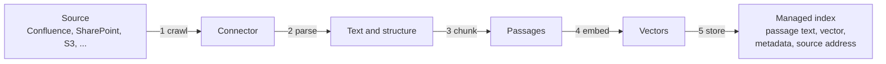
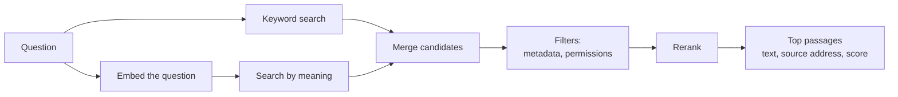
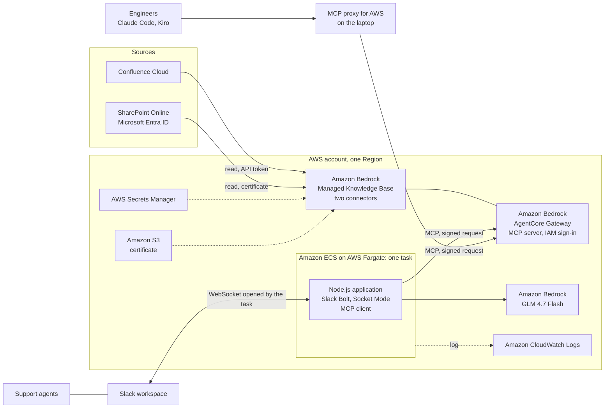

# Amazon Bedrock Managed Knowledge Base: An Introduction

This document explains Amazon Bedrock Managed Knowledge Base from the beginning: what it is, which sources it connects to, what it can do, how it indexes documents and answers a search, what can and cannot be configured, what it costs, and what this repository observed when using it. It is for readers who have not used the service: decision makers can read sections 1 to 4 and 9 to 11; engineers will want all of it.

The service is new (announced in June 2026) and changes often. Facts about the service come from the AWS documentation as read on 2026-10-13 (section 12); check that documentation before relying on a list or a number. Observations from this repository are marked as such. The setup steps used here are in [08-knowledge-base-chatbot.md](08-knowledge-base-chatbot.md), and the concept built on it is in [poc/03-knowledge-base-chatbot.md](poc/03-knowledge-base-chatbot.md).

## 1. The problem it solves

A large language model (LLM) knows what it was trained on. It does not know a company's warranty policy, last month's incident report or the price list in a spreadsheet. The usual way to let it answer from such content is **retrieval-augmented generation (RAG)**:

1. **Before any question:** read the company's documents, turn them into text, cut the text into small passages, and store the passages in an index that can be searched.
2. **For each question:** search the index for the passages closest to the question, and hand those passages to the LLM together with the question. The LLM writes the answer from them.

Building step 1 and the search of step 2 by hand means running a pipeline: connectors to each source, parsers for each file format, a chunking rule, an embedding model, a vector database, a ranking step, and the jobs that keep all of it in sync with the sources. A **knowledge base** in Amazon Bedrock is that pipeline as a service.

## 2. What a Managed Knowledge Base is

Amazon Bedrock Knowledge Bases comes in two kinds:

- **Managed Knowledge Base.** AWS runs everything: ingestion, parsing, chunking, embedding, storage, index and search. The team connects the sources and calls the search. There is no vector database to choose, size or pay for by the hour. AWS recommends this kind for new work.
- **Customer-managed Knowledge Base.** The team chooses and operates the vector store (for example Amazon OpenSearch Serverless, Amazon Aurora or Amazon Neptune) and controls each step of the pipeline.

| | Managed | Customer-managed |
|---|---|---|
| Data store | Managed by Bedrock, scales by itself; holds embeddings, text, metadata and the raw files | A vector store the team chooses, provisions and scales |
| Connectors to outside systems | Native connectors (section 3) | Amazon S3 and custom only |
| Parsing | A built-in parser that picks its method per file type | The team chooses: default text parser, a foundation model, or Bedrock Data Automation |
| Chunking | Default, fixed-size or none | Default, fixed-size and further strategies |
| Embedding model | A managed model at no extra cost, or the team's own Bedrock embedding model | The team's own Bedrock embedding model |
| Search | Hybrid (keywords and meaning), always | The team chooses the search strategy |
| Ranking of results | A managed reranker at no extra cost, the team's own, or none | The team's own, or none |
| Agentic retrieval | Supported | Not supported |
| Document-level permissions | Supported | Not supported |
| Amazon Bedrock AgentCore Gateway (MCP) integration | Native | Not supported |
| Direct access to the vector database | No | Yes |
| Best for | End-to-end RAG with connectors, without infrastructure | A specific vector database or search configuration |

A Managed Knowledge Base returns **passages**, not finished answers. Writing the answer is the caller's job (as in this repository, where the Slack bot calls an LLM), unless agentic retrieval is asked to write one (section 6).

## 3. Connectors

A **data source** is one connection from the knowledge base to one place where documents live. A knowledge base can have up to 200 data sources. Each data source uses a **connector**.

Connectors listed in the AWS documentation on 2026-10-13:

| Connector | What it reads |
|---|---|
| Amazon S3 | Files in a bucket. Needs no stored credential, only permission on the bucket |
| Confluence Cloud | Spaces: pages, blog posts and their attachments, with filters by space |
| Confluence Data Center | The same, for a self-hosted Confluence reached over a private network connection |
| Microsoft SharePoint Online | Sites: files in document libraries, and site pages |
| Microsoft OneDrive | Files in users' drives |
| Google Drive | Files in drives |
| Box | Files |
| Salesforce | Content of a Salesforce organisation |
| ServiceNow | Content of a ServiceNow instance, such as knowledge articles |
| Zendesk | Content of a Zendesk account, such as help centre articles |
| Web Crawler | Public web pages, starting from given addresses, within limits the team sets |
| Custom | Documents the team pushes itself through the API, for any source without a connector |

The list has grown since launch (six connectors in June 2026; Salesforce, Zendesk, ServiceNow and Confluence Data Center were added in September 2026), and AWS pages disagree on it at any given moment. Take the current list from [Create a managed knowledge base](https://docs.aws.amazon.com/bedrock/latest/userguide/kb-managed-create.html) and the details of each connector from [Connect a data source](https://docs.aws.amazon.com/bedrock/latest/userguide/kb-managed-connect-ds.html). In AWS GovCloud only the S3 connector is offered. What each connector reads, in the table above, is a summary; the connector's own page is the reference.

**How a connector signs in.** Every connector to an outside system needs an identity in that system. The credential is stored in AWS Secrets Manager, never in the data source's settings, and the knowledge base's service role is the only identity allowed to read it. The sign-in method depends on the connector. The two used in this repository:

| Connector | Sign-in used here | What the source's administrator provides |
|---|---|---|
| Confluence Cloud | Basic: an Atlassian account's email and API token | An account that can read the spaces to index, and its token |
| SharePoint Online | Microsoft Entra ID, app-only: an application with a certificate, no user | An application registration with read permission on the sites, and administrator consent |

Other methods exist per connector, including a sign-in by an administrator in the browser (OAuth) for SharePoint, OneDrive and Confluence, service accounts for Google Drive, and client credentials for Box and Zendesk. If document permissions are to be carried over (section 7), the method is prescribed per connector.

**Options common to connectors:**

- **Filters:** which spaces, sites, folders or file types to include or leave out, and a maximum file size.
- **Sync schedule:** on demand (the default), daily, weekly on a chosen day, or monthly on a chosen day. AWS chooses the time of day.
- **Deletion safeguard:** if one sync would remove more than a set share of the indexed documents (15% by default), the removal is skipped. This protects against a source that is temporarily empty or unreachable.
- **Media:** whether to also index pictures, audio and video (section 5).
- **Private network:** a connector can reach a source inside a VPC.

## 4. Features at a glance

| Feature | What it gives |
|---|---|
| Managed storage and index | No vector database to run; up to 10 TB of source data per knowledge base |
| Native connectors | Content stays in the source systems and is copied for search |
| Smart parsing | One parser for Word, Excel, PowerPoint, PDF, HTML, text and scanned documents, choosing its method per file |
| Incremental sync | Each sync processes only what was added, changed or deleted |
| Hybrid search | Every search combines keyword matching and matching by meaning |
| Managed reranking | A second model re-orders the candidates by relevance, at no extra cost |
| Agentic retrieval | For complex questions: plans several searches, checks whether it has enough, and can write the answer |
| Multimodal content | Pictures, audio and video can be indexed and found by text |
| Document-level permissions | Results can be filtered by what the asking person may read in the source |
| Metadata filters | A search can be limited by attributes of the documents |
| MCP through AgentCore Gateway | Any AI agent that speaks the Model Context Protocol can use the knowledge base as a tool, without custom code |
| Observability | Sync logs, retrieval traces and per-knowledge-base metrics |
| Encryption | At rest with an AWS key by default, or the team's own key; in transit always |
| Cross-account sharing | Resource policies can let another account query the knowledge base |

## 5. How indexing works

Indexing is called **ingestion** or **sync**. It runs when started by hand or by the schedule.

1. **Crawl.** The connector signs in and lists the documents within its filters. It compares them with the last sync and takes only the new, changed and deleted ones. With permissions enabled it also reads who may see each document.
2. **Parse.** Each document becomes text. The managed parser ("smart parsing") picks a method per file type: it keeps the structure of HTML and of document headings, reads tables, and reads scanned pages as images. It is the only parser for text content in a Managed Knowledge Base.
3. **Chunk.** The text is cut into passages. The default is fixed-size chunks of 300 tokens (roughly 200 to 250 English words) with 20% overlap between neighbours, so that a sentence on a boundary is not lost. The alternatives are a fixed size the team sets, or no chunking (one passage per document, for content that is already split). Semantic chunking is not offered. The choice is made when the data source is connected and cannot be changed afterwards.
4. **Embed.** An embedding model turns each passage into a vector: a list of about a thousand numbers that places the passage in a space where texts with similar meaning lie close together. That is what lets a question find a passage that uses different words, or another language.
5. **Store.** The passage's text, its vector, its metadata and the address of its source document (the page's URL, the file's URL) go into the managed index.

A sync ends with a status and counts: documents scanned, newly indexed, modified, deleted and failed. Failures carry a reason per document.

**Media.** By default only text is indexed. Three switches per data source add pictures (standalone image files, and pictures inside PDF, Word and PowerPoint files), audio files and video files; their content is described or transcribed and then indexed as text. Separately, a knowledge base can be created with a native multimodal embedding model, which embeds the raw picture, sound or video without turning it into text; that mode has its own restrictions and is chosen at creation.

**Freshness.** The knowledge base is as current as its last sync. A page edited at noon is found in its old version until the next sync.

## 6. How a search works

There are two operations.

### Retrieve: one search, passages back

1. The question is embedded with the same model as the passages.
2. Two searches run: one by meaning (nearest vectors) and one by keywords. A Managed Knowledge Base always uses this **hybrid** search; search by meaning alone is not offered.
3. The candidates are merged. Metadata filters, and the permission filter if enabled, remove what does not qualify.
4. A **reranker**, a model that reads the question and each candidate together, re-orders them. The managed reranker is on by default; the caller may name another Bedrock reranking model or turn reranking off.
5. The best passages are returned, as many as the caller asked for. Each has its text, the address of its source document, its metadata and a relevance score.

Retrieve does not judge whether the passages answer the question. It returns the closest ones it has, even when the question has nothing to do with the content. Deciding "the documents do not say" is left to the caller's LLM or to a score threshold the caller applies.

### AgenticRetrieveStream: a planned search

For a question that needs several facts ("which products under warranty were affected by last month's incident, and what compensation applies?"), one search often finds only part of the answer. Agentic retrieval puts an LLM in charge of the searching:

1. It splits the question into sub-questions and plans the searches.
2. It runs a search, reads the result, and decides whether it has enough.
3. If not, it searches again with a refined query, up to a set number of rounds.
4. It returns the passages it used and, if asked, a written answer with citations.

It can search several knowledge bases in one request, streams its result, and can have a Bedrock guardrail applied to the generated answer. It is slower and costs more per call than Retrieve (section 9).

### Calling it

| Way in | For |
|---|---|
| The Bedrock API (Retrieve, AgenticRetrieveStream) | An application with AWS credentials |
| Amazon Bedrock AgentCore Gateway | AI agents and tools that speak MCP. The gateway publishes the knowledge base as an MCP server with one tool per operation, and checks each caller with AWS IAM or with tokens from an identity provider. No function or container runs behind it |
| The console's test panel | Trying questions by hand |
| Amazon Quick | Using the knowledge base inside AWS's business assistant |

This repository uses the gateway for both of its clients, the Slack bot and the AI assistants in code editors, so that both go through one door with one set of rules.

## 7. Document permissions

By default a knowledge base knows nothing about who may read what: every caller finds every indexed document. **ACL awareness**, set per data source, changes that:

- **At sync** the connector also reads each document's permissions from the source: allowed and denied users and groups, and who belongs to each group.
- **At search** the caller passes the identity of the person asking, as an email address. Only passages from documents that person may read are returned. A denial always wins over an allowance.
- **Real-time check.** For SharePoint, OneDrive, Google Drive, Confluence, Box and Zendesk, the service also asks the source at search time whether the person still has access, which catches changes made since the last sync. S3 and custom sources take their permissions from a file the team supplies and have no such check. The web crawler has no permissions at all.
- **If the check fails**, the affected documents are withheld, not shown.

Three points decide whether this is usable:

- **It is a filter, not authentication.** The service believes the email it is given. The application must have established who is asking, and must not let a user claim another identity.
- **Emails must match.** The email passed must be the one the person has in each source. A mismatch returns nothing, silently.
- **It is chosen when the data source is connected.** In this repository's experience it could not be switched on for an existing data source; the source has to be connected again. Some sign-in methods are required for it (for example app-only for SharePoint, and an administrator's token for Confluence).

This repository left permissions off and indexed only content open to every user of the bot.

## 8. What can and cannot be configured

| Choice | Options | When | Changeable later |
|---|---|---|---|
| Embedding model | Managed (default), or one of the supported Bedrock models with 1,024 dimensions (Amazon Titan Text Embeddings V2, Cohere Embed v3 and v4, Amazon Nova Multimodal Embeddings), or a native multimodal model | Creating the knowledge base | No. A new knowledge base is needed |
| Encryption key | AWS key (default) or the team's own KMS key | Creating the knowledge base | No |
| Parser | Managed parser only, for text content | | |
| Chunking | Default (300 tokens, 20% overlap), fixed size, or none | Connecting the data source | No |
| Document permissions | On or off | Connecting the data source | No (as observed here) |
| Filters, sync schedule, deletion safeguard, media switches | Per data source | Connecting the data source | Yes |
| Number of results | Per search | Each search | |
| Reranker | Managed (default), own model, or none | Each search | |
| Metadata filter | Per search; the "starts with" and "contains" operators are not supported | Each search | |
| Search type | Hybrid only | | |
| Agentic retrieval: planning model, number of rounds, guardrail, whether to write an answer | Per request | Each request | |

Choosing an own embedding model switches off the managed reranker for that knowledge base, and its use is then billed at the model's price.

**Quotas** (defaults on 2026-10-13):

| Quota | Value |
|---|---|
| Managed knowledge bases per account and Region | 10,000 (adjustable) |
| Data sources per knowledge base | 200 |
| Concurrent sync jobs per knowledge base | 50 |
| Source data per knowledge base | 10 TB |
| Length of a question | 10,000 characters |
| Retrieve requests per knowledge base | 600 per minute, bursts of 25 per second (adjustable) |
| AgenticRetrieveStream requests per account | 300 per minute (adjustable) |

**Regions** (on 2026-10-13): US East (N. Virginia), US West (Oregon), Europe (Ireland), Europe (London), Europe (Frankfurt), Asia Pacific (Tokyo), Asia Pacific (Sydney), and AWS GovCloud (US-West) with a reduced feature set.

## 9. Cost

List prices on 2026-10-13, in USD. Check the [Amazon Bedrock pricing page](https://aws.amazon.com/bedrock/pricing/) for the Region in use.

| Item | Price |
|---|---|
| Storage and index | 5.00 per GB of source data per month |
| Parsing with the managed parser | 0 |
| Embedding with the managed model | 0 |
| Retrieve | 1.00 per 1,000 calls |
| Reranking with the managed reranker | 0 |
| Agentic retrieval with the managed planning model | 4.00 per 1,000 calls, plus 1.00 per 1,000 searches it runs underneath |

- An own embedding, reranking or planning model is billed at that model's price.
- Calls through AgentCore Gateway add the gateway's charge per tool call. Secrets for connectors cost 0.40 per secret per month. Logs are billed at Amazon CloudWatch rates.
- The LLM that writes the final answer from the passages is separate, and is the caller's choice.
- Nothing bills by the hour. A knowledge base that nobody queries costs its storage.

Two numbers drive the bill: the size of the indexed content, and the number of searches. One hundred megabytes of documents and 1,000 questions a month is about 1.5 USD; 10 GB and 20,000 questions is about 70 USD.

## 10. What this repository observed

### An example application: a support chatbot

This repository uses a Managed Knowledge Base for a customer-support chatbot in Slack. It shows the parts of an application built on the service, and how little of it the team has to write.

- **Sources.** The support knowledge stays in Confluence Cloud and SharePoint Online. Two connectors copy it into the knowledge base once a day; their credentials sit in Secrets Manager and, for the SharePoint certificate, in an encrypted S3 bucket.
- **Knowledge base.** It parses, chunks, embeds and indexes the pages and files (section 5). Nothing here was written or operated by the team.
- **Gateway.** AgentCore Gateway publishes the knowledge base as an MCP server and checks every caller with AWS IAM. It is the one door for all clients.
- **Slack bot.** The only code the team wrote: a small Node.js application, drawn here as one always-on container on Amazon ECS on AWS Fargate inside the same AWS account (in this repository's run it was started from a laptop instead). It receives a question from Slack, calls Retrieve through the gateway for eight passages (section 6), has an LLM on Amazon Bedrock write the answer from them, and replies with links to the cited pages and files.
- **Engineers.** The AI assistants in their code editors reach the same gateway through a local proxy that signs requests with each engineer's AWS identity.

The concept, its safeguards and its results are described in [poc/03-knowledge-base-chatbot.md](poc/03-knowledge-base-chatbot.md); the setup steps are in [08-knowledge-base-chatbot.md](08-knowledge-base-chatbot.md).

### Observations

One knowledge base with every setting at its default, two data sources (Confluence Cloud and SharePoint Online), invented content mostly in Vietnamese. These are observations from one small setup, not properties guaranteed by the service.

| Observation | Detail |
|---|---|
| Sync was reliable | 137 Confluence documents and 97 SharePoint documents indexed, none failed. The first sync of each source took a few minutes |
| Formats were read as expected | Wiki pages, blog posts, Word, Excel (including a value in one cell), PDF, HTML, CSV, Markdown and text files were all searchable. A PDF attached to a Confluence page was found through the Confluence connector |
| Search by meaning worked across spelling and language | Questions typed without Vietnamese accents, and questions in English about Vietnamese documents, found the right passages. The expected fact was in the results for 28 of 28 test questions |
| Word and PDF text lost some Vietnamese accents | Passages from Word and PDF files came back with accents missing or wrong, while Excel, HTML, text and wiki content was intact. The cause was not determined; it looks like those files were read as images |
| Passages are short | A few hundred words each, consistent with the default chunking |
| The requested number of passages always came back | Eight were asked for and eight were returned, also for a question unrelated to the content. The caller must handle "no answer" |
| Latency was low | A search through the gateway and the LLM's answer together took 2.6 to 4.3 seconds |
| The gateway needed no code | The knowledge base was added to an AgentCore Gateway as a target, and two tools appeared: one for Retrieve, one for agentic retrieval |
| Request shape differs from the customer-managed kind | Search settings go in a field for managed search; requests written for a customer-managed knowledge base need that one change |

Not tried here: agentic retrieval, document permissions, media, metadata filters, an own embedding or reranking model, the schedule over several days, and any connector other than Confluence Cloud and SharePoint Online.

## 11. When to choose it

| A Managed Knowledge Base fits when | Look elsewhere when |
|---|---|
| The content is documents in the systems it has connectors for | The content is rows in a database or a data warehouse. Bedrock has a separate kind of knowledge base for structured data |
| The team wants search over documents without operating a database | A specific vector database, search method or chunking method is required. That is the customer-managed kind |
| A day's delay between an edit and its appearance in search is acceptable | Content must be searchable within minutes of a change, unless the team pushes documents itself through the custom connector |
| Several clients (a chatbot, AI agents, code editors) should share one source of knowledge | The Region the organisation must use is not on the list |
| The workload is small or uneven, so paying per use matters | |

## 12. Sources

AWS documentation and announcements, read on 2026-10-13:

- [Amazon Bedrock Knowledge Bases](https://docs.aws.amazon.com/bedrock/latest/userguide/knowledge-base.html): the two kinds of knowledge base
- [How Amazon Bedrock knowledge bases work](https://docs.aws.amazon.com/bedrock/latest/userguide/kb-how-it-works.html): RAG, chunks and embeddings
- [Build a managed knowledge base](https://docs.aws.amazon.com/bedrock/latest/userguide/kb-build-managed.html): comparison with the customer-managed kind
- [Create a managed knowledge base](https://docs.aws.amazon.com/bedrock/latest/userguide/kb-managed-create.html): embedding options and the connector list
- [Connect a data source](https://docs.aws.amazon.com/bedrock/latest/userguide/kb-managed-connect-ds.html): connector options, with one page per connector
- [Customize ingestion for a data source](https://docs.aws.amazon.com/bedrock/latest/userguide/kb-managed-customize-ingestion.html): parsing and chunking
- [Sync a data source](https://docs.aws.amazon.com/bedrock/latest/userguide/kb-managed-sync.html): incremental sync and schedules
- [Access Control Lists awareness enablement](https://docs.aws.amazon.com/bedrock/latest/userguide/kb-managed-acl.html): document permissions
- [Native multimodal processing](https://docs.aws.amazon.com/bedrock/latest/userguide/kb-managed-native-multimodal.html)
- [Query a knowledge base and retrieve data](https://docs.aws.amazon.com/bedrock/latest/userguide/kb-test-retrieve.html): hybrid search and reranking
- [Connect to your knowledge base through AgentCore Gateway](https://docs.aws.amazon.com/bedrock/latest/userguide/kb-gateway-target.html)
- [Service quotas for managed knowledge bases](https://docs.aws.amazon.com/bedrock/latest/userguide/kb-managed-quotas.html)
- [Supported AWS Regions](https://docs.aws.amazon.com/bedrock/latest/userguide/kb-managed-regions.html)
- [Amazon Bedrock pricing](https://aws.amazon.com/bedrock/pricing/)
- [Introducing Amazon Bedrock Managed Knowledge Base](https://aws.amazon.com/blogs/aws/introducing-amazon-bedrock-managed-knowledge-base-for-faster-more-accurate-enterprise-ai-applications/) (AWS News Blog, June 2026)
- [Salesforce and Zendesk connectors](https://aws.amazon.com/about-aws/whats-new/2026/09/amazon-bedrock-managed-knowledge-base-salesforce-zendesk-native-data-source-connectors/), [ServiceNow connector](https://aws.amazon.com/about-aws/whats-new/2026/09/amazon-bedrock-managed-knowledge-base-servicenow-native-data-source-connector/), [Confluence Data Center connector](https://aws.amazon.com/about-aws/whats-new/2026/09/amazon-bedrock-managed-knowledge-base-confluence-data-center-native-data-source-connector/) (AWS What's New, September 2026)
