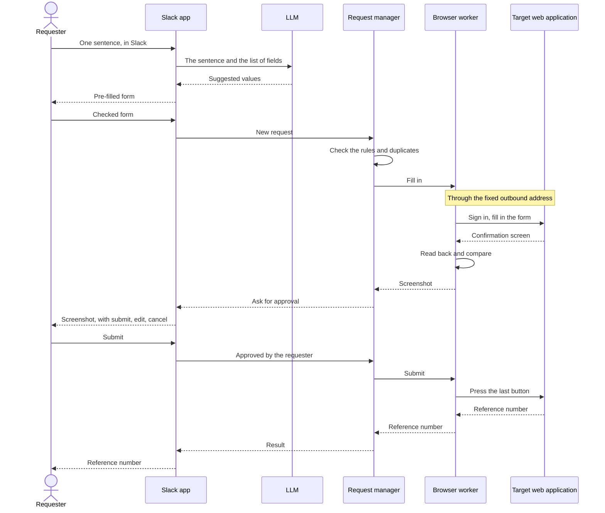
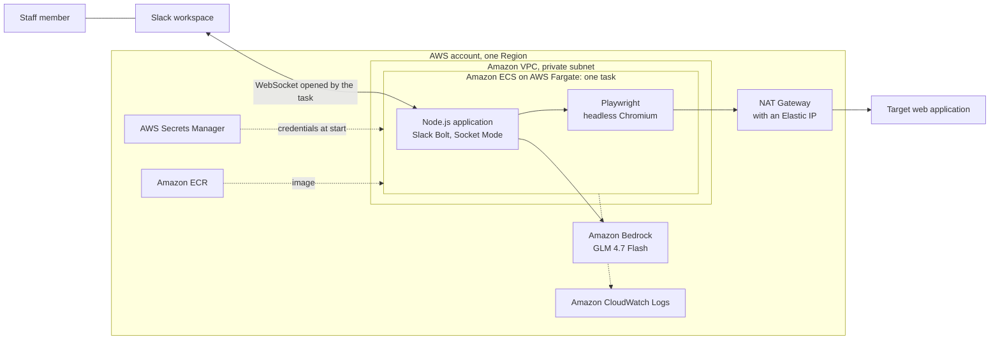

# POC 1: Web Form Automation

This document describes a concept that has been built and run end to end. It is written for decision makers: what the concept automates, how it works, what was proven and what was not, what it costs, and what the team must be granted before it can be applied to a real web application.

It contains no code and needs none to be read. A sample implementation and the engineering documents are in the project's repository (section 11).

## 1. Summary

| | |
|---|---|
| **What it does** | A staff member writes one sentence in Slack. The system prepares the form, signs in to a web application that has no API, fills the form in and stops at the confirmation screen. It submits only after that person has seen the screen and approved it |
| **Problem it answers** | Routine data entry into web applications that can only be used through their screens |
| **Status** | Ran end to end on AWS, most recently on 2026-10-11, against a simulated website. Not yet run against a real web application |
| **Running cost** | About 82 USD a month when the web application requires a registered IP address, about 39 USD when it does not. The cost does not grow with the number of requests |
| **Needed to go further** | The agreement of the web application's owner, a dedicated account and one registered IP address there, an approved Slack app, and a cloud environment the team may build in (section 7) |

## 2. The use case

Staff repeat the same entry work in internal and partner web applications: registering a visitor, booking a resource, filing a request. The information fits in one sentence. The work is typing it into many fields over several screens.

Where the application offers an API, a system can do this directly. Many do not, and some also accept connections only from IP addresses registered in advance. This concept is for those.

The example that was built is a visitor registration: fifteen fields over a three-step form, on a simulated website with the kind of rules a real one has. One of those rules only the website can check: two registrations that overlap.

| The concept fits when | It does not fit when |
|---|---|
| The steps are the same every time and the input is structured | The volume comes in large batches |
| The web application offers no usable API | An API exists. Use it |
| Its owner allows automated use through an account issued for that purpose, and will register one IP address | Its terms forbid automated use |
| A wait of a few seconds is acceptable | Every sign-in asks for a CAPTCHA or a one-time code |
| Someone will maintain the automation when the screens change | The screens change often and nobody owns the upkeep |

Three alternatives were considered. Asking the owner for an API is the best answer wherever one can be had. A commercial RPA product brings a licence and a platform to run for a single task. Letting the LLM operate the browser by itself is slow, costs more per request and does not behave the same way twice.

## 3. How it works

The names in this section are generic. The services and technologies the POC used for each of them are in section 4.

### 3.1 The components

| Component | What it does |
|---|---|
| **People and outside systems** | |
| Requester | The staff member who asks, and the only person who may approve |
| Slack | Where the requester writes the request, checks the form and approves |
| LLM | Turns the sentence into suggested form values. It suggests and does nothing else |
| Target web application | The system with no API, used through its screens with an account issued for the automation |
| **The system** | |
| Slack app | The system's side of the conversation: receives the command, shows the form, sends the screenshot, takes the approval |
| Form definition | One description of the fields, their allowed values and their rules. The form in Slack, the instructions to the LLM and the browser's work all follow from it |
| Request manager | Owns each request from form to result: the rule checks, duplicates, the wait for approval, who may approve, expiry |
| Browser worker | A browser without a screen, driven by a fixed script: signs in, fills in the form, reads the confirmation back, takes the screenshot, submits |
| **The environment it runs in** | |
| Container runtime | Keeps the system running as one container, always on |
| Image registry | Stores the packaged system that the runtime starts |
| Secret store | Holds the Slack credentials and the web application account, and hands them to the system when it starts |
| Private network with a fixed outbound address | The system accepts no incoming connection. Everything it sends leaves through one address, which the web application's owner registers |
| Log store | One line per event, with secrets removed |
| Access roles | What the system itself may do in the cloud: call the one LLM model, and nothing else |
| Infrastructure templates | Create and remove the whole environment the same way every time |

**The Slack app is one thing in two places.** What a Slack administrator creates in the workspace is a registration: the bot's name, its permissions and its commands. By itself it does nothing. The work is done by the program the team runs, here in the cloud. Slack issues secret codes for the app; the program keeps them in the secret store and uses them to call Slack and say which bot it is. Creating the app in Slack therefore deploys nothing, and stopping the program leaves a bot that is listed in Slack and does not answer.

### 3.2 The flow

**When the system starts.** The container runtime takes the packaged system from the image registry, starts it inside the private network and hands it its credentials from the secret store. The Slack app then opens a connection out to Slack and keeps it open. Requests arrive over that connection, so nothing has to be reachable from the internet.

**For each request:**

| Step | Components | What happens |
|---|---|---|
| 1. Ask | Requester, Slack, Slack app | The requester types a command followed by one sentence, for example "Mr Tanaka from Acme, tomorrow at 2 pm, head office, floor 12". Slack passes it to the Slack app |
| 2. Pre-fill | Slack app, form definition, LLM | The sentence goes to the LLM with the list of fields and their allowed values. The LLM returns suggested values, and any that do not fit the form definition are dropped. If the LLM fails, the form opens empty and the rest works the same |
| 3. Review | Slack app, requester | The form opens in Slack, pre-filled, with a note to check every field. The requester corrects it and sends it |
| 4. Check | Request manager, form definition | The values are checked against the rules. A broken rule is shown on its field, and the browser is not started. A request the same person has already made is refused, with its reference number if it was submitted |
| 5. Fill | Browser worker, fixed outbound address, target web application | The worker opens a browser, signs in with the dedicated account and fills in the form screen by screen, as far as the confirmation screen. If the web application rejects a value, its message goes to the requester word for word. If sign-in fails, or asks for a CAPTCHA or a one-time code, the worker stops and the requester is told that a person is needed |
| 6. Read back | Browser worker | The worker reads the confirmation screen, compares it with what the requester sent and takes a screenshot. If the two differ, it stops, the fields are named and no approval is offered |
| 7. Ask for approval | Slack app, request manager | The requester receives the screenshot and a summary of the values by direct message, with three choices: submit, edit or cancel. The request waits with the browser still open on the confirmation screen, so what the screenshot shows is exactly what will be submitted |
| 8. Finish | Request manager, browser worker, Slack app | Submit: the worker presses the last button and the reference number is returned to the requester. Edit: the form reopens with the same values, and sending it replaces the waiting request. Cancel, or no answer within ten minutes: the browser is closed and nothing is submitted. A click by anyone other than the requester is refused |

Every step writes a line to the log store.

## 4. What it is made of

The POC built each component of section 3 with the services and technologies below. Everything on the cloud side sits in one AWS account and one Region.

The diagram shows who talks to whom. On the network, every connection the task opens leaves through the NAT Gateway: to Slack, to Amazon Bedrock and to the web application.

| Component | Built with | Notes |
|---|---|---|
| Slack app | Node.js 22 or later (JavaScript), with Slack's Bolt framework in Socket Mode | Socket Mode is a WebSocket that the application opens out to Slack. The system needs no public address |
| Form definition, request manager | Plain JavaScript in the same application | Requests waiting for approval are held in the memory of that one process |
| LLM | Amazon Bedrock, model GLM 4.7 Flash | Called with the system's own access role, without an API key, so the sentence stays inside AWS. Also run with DeepSeek V4.1 Flash through OpenRouter, an outside provider |
| Browser worker | Playwright driving headless Chromium | Runs inside the same container, and is the reason for the container's size |
| Target web application | A simulated website, in a second container beside the system | To be replaced by the real web application |
| Container runtime | Amazon ECS on AWS Fargate | One task, always on: 1 vCPU, 2 GB of memory, ARM64 |
| Image registry | Amazon ECR | One Docker image, about 1 GB compressed because it carries the browser |
| Secret store | AWS Secrets Manager | One secret: the Slack tokens and the web application account |
| Private network with a fixed outbound address | Amazon VPC with a private subnet, and one NAT Gateway with an Elastic IP | A security group with no inbound rule, and outbound HTTPS only. The Elastic IP is the address the web application's owner registers |
| Log store | Amazon CloudWatch Logs | Kept for 7 days |
| Access roles | AWS IAM, two roles | One lets ECS start the container: pull the image, read the secret, write the log. The other lets the application call the one Bedrock model |
| Infrastructure templates | AWS CloudFormation, two stacks | One for the image registry and the secret, one for everything else |

## 5. Safeguards

| Concern | What the design does |
|---|---|
| Something is submitted that nobody checked | Nothing is submitted without approval of the exact screen. Only the person who asked can approve, edit or cancel |
| The LLM is wrong, or is steered by the text it reads | The LLM only suggests form values, and the requester reviews them. It never starts an action, and the request text is treated as data, not as instructions |
| The web application shows something other than what was asked | The read-back stops the request and names the fields that differ |
| The same request is submitted twice | A repeated request is refused, with the reference of the first |
| The web application rejects the request | Its own message is passed on to the requester word for word |
| Sign-in meets a CAPTCHA or a one-time code | The system stops and says a person is needed. It does not try to get around them |
| Personal data shows up where it should not | The details and the screenshot go to the requester by direct message, not to a channel |

## 6. What was verified

Every run used the simulated website.

| Run | Result |
|---|---|
| Automated tests on a workstation, with a real browser | The form rules, the browser steps and the Slack exchange behave as described |
| On AWS, 2026-10-05, without a fixed IP address, five requests from Slack | Nothing was submitted without approval: the two approved requests received reference numbers, the two cancelled requests submitted nothing. When the website rejected a request, its own message reached the requester |
| On AWS, 2026-10-11, behind a fixed IP address, with the LLM on Amazon Bedrock | The address the system leaves through was confirmed to be the fixed one. A request from Slack was approved and submitted; the same request sent again was refused as a duplicate |

Measured: one to 2.5 seconds from the sentence to the pre-filled form, about four seconds from the form to the screenshot, about 40 seconds for the system to start, and a peak of about 10% of the memory allocated. No secret was found in the log.

**The LLM works, and is not yet good enough.** An acceptance test of ten sentences covers English, Vietnamese, Japanese, abbreviations, missing information and an instruction written in place of a request. A small model from an outside provider (DeepSeek V4.1 Flash through OpenRouter) passed ten. The model tried on Amazon Bedrock (GLM 4.7 Flash) passed seven: one date a day off, one floor missed, one building guessed. None of these can reach the website unseen, because the requester reviews the form and the screenshot, but each is a correction the requester has to make.

**Not verified:**

- A real web application, single sign-on, or a CAPTCHA.
- Several requests waiting for approval at the same time, and recovery after the system restarts.
- The ten-minute expiry on AWS.

## 7. What the team needs to be granted

Most of the time between a decision and a running system is spent waiting for these. They can be requested in parallel.

| # | What | From whom | Notes |
|---|---|---|---|
| 1 | Written agreement to automated use of the web application | The web application's owner | Without it, do not start. Automated access may be against the terms of use |
| 2 | A dedicated account on the web application, with the least permissions the task needs, exempt from CAPTCHA and one-time codes | The web application's owner | Everything done there is recorded under this account. Ask as well for a test environment or agreed test records, and for notice when screens change |
| 3 | One IP address added to the web application's list of allowed addresses | The web application's owner | The address is known only once the cloud environment exists, and it changes if that environment is removed |
| 4 | Approval to install a custom Slack app | Slack workspace administrator | The app receives its own command, posts messages, sends direct messages and uploads the screenshot. It cannot read channels or messages. Permission names for the approver: `commands`, `chat:write`, `im:write`, `files:write` |
| 5 | An AWS account or sandbox, in one Region, where the team may build | Cloud or platform team | The team creates a private network with a fixed public IP address (VPC, NAT Gateway, Elastic IP), a container service (ECS on Fargate, ECR), one secret, logs and two service roles, all through CloudFormation |
| 6 | Use of Amazon Bedrock for the chosen model | Cloud team, and AWS | Three conditions: the model is offered in the Region, the model provider's agreement is accepted, and the account is allowed to use Bedrock. In some accounts only AWS Support can lift the last one, which makes it the longest wait on the cloud side |
| 7 | A decision that the request sentence may be sent to the LLM | Data owner or security | The sentence can hold a visitor's name, company and phone number. The screenshot, with the same data, is stored in Slack |
| 8 | Named owners | Leadership | One person for the deployment and its credentials, and one to maintain the browser script when the web application changes |

Not needed: any permission to read Slack messages, access to Jira or Confluence, or any opening from the internet into the organisation's network.

## 8. Cost

Example figures from AWS list prices in one Region (Asia Pacific, Sydney) in October 2026, in USD, before tax and discounts.

| Situation | USD per month |
|---|---|
| Running all month behind a fixed IP address | about 82 |
| Running all month without a fixed IP address | about 39 |
| Stopped, with the network and the address kept | about 47 |
| Removed, with only the stored image and secret kept | about 0.5 |
| Everything removed | 0 |

- The cost is fixed. It pays for a container that is always on and for the network, and it does not grow with the number of requests at this scale.
- The fixed IP address is more than half of it: about 47 of the 82 USD. Only a web application that restricts by address needs it.
- The LLM is negligible: about 0.05 USD for 500 requests a month, and under 2 USD with a model forty times the price.
- A second environment, for example test and production, doubles the total and needs a second address registered.
- People are not in these figures: writing the browser script for each real web application, and maintaining it.

## 9. Risks and what remains

| Risk | Effect | Answer |
|---|---|---|
| The web application changes its screens | The system stops filling in the form until the script is updated | The read-back turns a changed screen into a clear error, not a wrong submission. Someone must own the upkeep |
| A CAPTCHA or a one-time code is introduced | The system stops and asks for a person | Agree a dedicated account that is exempt |
| The terms of the web application forbid automated use | Legal exposure and a locked account | Written agreement first |
| Personal data in the request text and the screenshots | A compliance duty | Rules on where they are stored, for how long, and who may see them |
| Other systems share the fixed IP address | They would reach the web application from the registered address | Keep that network for this system alone |

The POC is not a production system. Before it serves more than a pilot group it needs:

- a list of who may use it (today, anyone in the workspace can);
- a durable record of requests waiting for approval (today they are held in memory and lost on a restart);
- an audit record of who asked, who approved and when;
- monitoring, with a scheduled test request that stops before submitting;
- a model that passes the whole acceptance test;
- deployment through a reviewed pipeline, and a rotation schedule for the credentials.

## 10. Next steps

1. Choose one real web application and obtain its owner's agreement (section 7, items 1 to 3).
2. Send the Slack, cloud and Bedrock requests at the same time (items 4 to 6). They have the longest waits.
3. Adapt the form definition and the browser script to that application, and run them against its test environment.
4. Choose the model on quality, with the acceptance test.
5. Close the gaps in section 9 before widening the group of users.

## 11. Where the detail is

This document stops at the concept. The sample implementation, the steps to run it, and the documents shared by all POCs are in the project's GitHub repository: start with the [README](../../README.md), then the platform's [overview](../01-platform-overview.md), [architecture](../02-platform-architecture.md), [AWS deployment](../03-aws-deployment.md), [operating cost](../04-operating-cost.md) and [prerequisites and access](../05-prerequisites-and-access.md).
