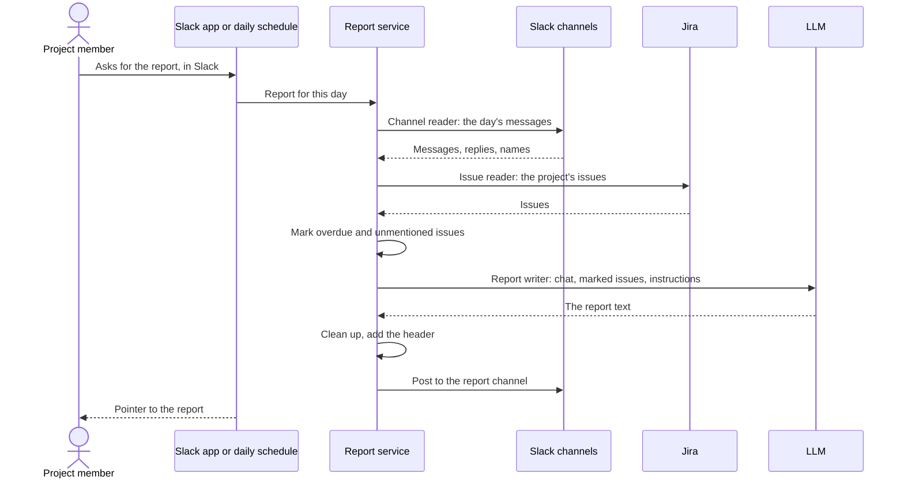
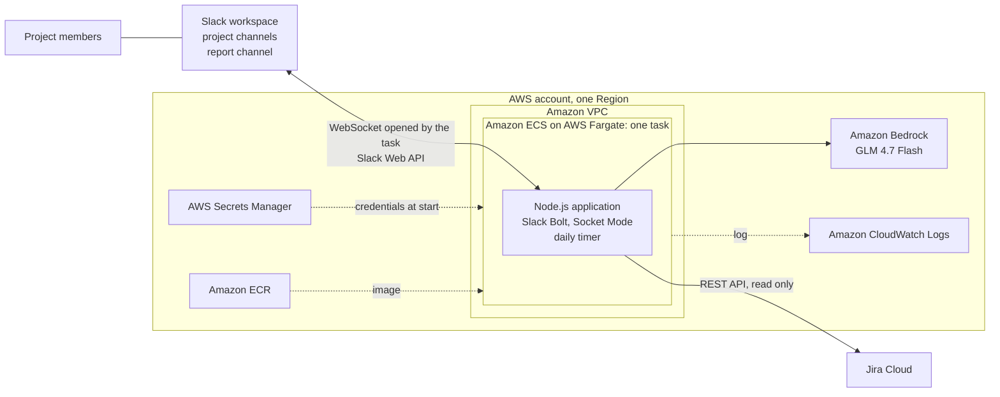

# POC 2: Daily Report

This document describes a concept that has been built and run end to end. It is written for decision makers: what the concept automates, how it works, what was proven and what was not, what it costs, and what the team must be granted before it can be piloted on a real project.

It contains no code and needs none to be read. A sample implementation and the engineering documents are in the project's repository (section 11).

## 1. Summary

| | |
|---|---|
| **What it does** | The system reads the day's messages in a project's Slack channels and the project's Jira issues, has an LLM write the daily report, and posts it to one fixed channel. The report points out where the chat and Jira disagree |
| **Problem it answers** | Someone reads a day of chat and the task board to write a status report, and the chat and the board drift apart without anyone noticing |
| **Status** | Ran from a laptop on 2026-10-06 and on AWS on 2026-10-11, against a real Slack workspace and a real Jira Cloud site, both filled with invented data. Not yet tried on a real project |
| **Running cost** | About 39 USD a month by itself. Almost nothing when added to a deployment that already runs |
| **Needed to go further** | A decision that a day of project chat may be sent to an LLM, a Slack app allowed to read the project's channels, a read-only Jira account, and a cloud environment the team may build in (section 7) |
| **What it is not** | A record of truth. The report is a draft for a person to check |

## 2. The use case

A project lead writes the daily report by reading the day's messages and checking the task board. It takes time every day. It also misses what no one person sees: the chat says a piece of work is finished while Jira still shows it in progress, or an issue passes its due date and nobody mentions it.

| The concept fits when | It does not fit when |
|---|---|
| The working talk happens in a few Slack channels | Decisions are made in direct messages, calls and meetings |
| Work is tracked in Jira Cloud | The tracker is Jira Server, Jira Data Center or another product |
| People write the issue key when they talk about an issue | Issues are referred to by description only |
| Someone reads the draft before relying on it | The report must be correct without a check |
| The chat and the issue list may be sent to an LLM provider | The data owner forbids it |

## 3. How it works

The names in this section are generic. The services and technologies the POC used for each of them are in section 4.

### 3.1 The components

| Component | What it does |
|---|---|
| **People and outside systems** | |
| Project members | Ask for a report, and read it in the report channel |
| Slack | The project's channels, which are read, and one report channel, which is written |
| Jira | The project's issues, which are read and never changed |
| LLM | Writes the text of the report from what it is given. It writes and does nothing else |
| **The system** | |
| Slack app | The system's side of the conversation: receives the request, answers the person who asked, posts the report |
| Daily schedule | A timer that starts the day's report at a set time, without anyone asking |
| Channel reader | Collects the day's messages of each configured channel, with thread replies, people's names and file names, in the order they were written. Leaves out join and leave notices and the system's own earlier reports |
| Issue reader | Runs one read-only query and keeps, for each issue, its key, summary, type, status, assignee, priority, due date and last update |
| Report service | Runs one report from start to end: the day's time window, the marks on each issue, the fallback when Jira fails, the clean-up, the posting |
| Report writer | Holds the fixed instructions and makes the call to the LLM |
| **The environment it runs in** | |
| Container runtime | Keeps the system running as one container, always on |
| Image registry | Stores the packaged system that the runtime starts |
| Secret store | Holds the Slack and Jira credentials, and hands them to the system when it starts |
| Private network | The system accepts no incoming connection. It needs no fixed outbound address, unless the Jira site restricts access by address |
| Log store | One line per event, with secrets removed |
| Access roles | What the system itself may do in the cloud: call the one LLM model, and nothing else |
| Infrastructure templates | Create and remove the whole environment the same way every time |

**The Slack app is one thing in two places.** What a Slack administrator creates in the workspace is a registration: the bot's name, its permissions and its commands. By itself it does nothing. The work is done by the program the team runs, here in the cloud. Slack issues secret codes for the app; the program keeps them in the secret store and uses them to call Slack and say which bot it is. Creating the app in Slack therefore deploys nothing, and stopping the program leaves a bot that is listed in Slack and does not answer.

### 3.2 The flow

**When the system starts.** The container runtime takes the packaged system from the image registry, starts it inside the private network and hands it its credentials from the secret store. The Slack app then opens a connection out to Slack and keeps it open, and the daily schedule is set for its time. Requests arrive over that connection, so nothing has to be reachable from the internet.

**For each report:**

| Step | Components | What happens |
|---|---|---|
| 1. Start | Project member and Slack app, or the daily schedule | A project member types a command in Slack, for today or with an earlier date, and the Slack app tells that person privately that the report is being written. At the set time, the daily schedule starts the same work for today |
| 2. Set the day | Report service | The day runs from midnight to midnight, local time. For today it ends at the moment of the request |
| 3. Read the chat | Channel reader, Slack | That day's messages are read from every configured channel, with their replies and the names of the people who wrote them |
| 4. Read the issues | Issue reader, Jira | The project's open issues, and those updated in the last day, are read, up to 100. If Jira does not answer, the work goes on from the chat alone and the header of the report says why |
| 5. Mark | Report service | Before the LLM is involved, each issue is marked by rule: overdue when its due date is before the report's date and it is not done, and not mentioned when its key does not appear in the day's messages. With no messages and no issues, the report is one line and the LLM is not called |
| 6. Write | Report writer, LLM | The chat, the marked issue list and the fixed instructions go to the LLM in one call. The instructions set the sections of the report and the findings of the Jira check, and tell the LLM to treat everything in the chat and the issues as content to report on, never as instructions |
| 7. Clean up | Report service | Mentions of people and groups become plain text, so that nobody is notified. The header is added, and a long report is split into several messages |
| 8. Post | Slack app, Slack | The report goes to the one report channel. The person who asked receives a private pointer to it, not the report itself |
| 9. If it fails | Report service, Slack app, log store | If Slack cannot be read or the LLM fails, nothing is posted and the person who asked is told why. A scheduled run records the failure, does not retry, and is set again for the next day |

Every step writes a line to the log store.

**The report.** A header gives the date, the number of messages and issues read, and a notice that an LLM wrote the report and that it should be checked. Eight sections follow, always in the same order: summary, done today, in progress, blockers and risks, decisions, open questions, Jira check, next steps.

**The Jira check** reports four things: issues that are overdue; issues the chat says are finished while Jira does not; issues the chat says are blocked or slipping; and open issues due within three days that nobody mentioned. Issues that are on track are left out.

## 4. What it is made of

The POC built each component of section 3 with the services and technologies below. Everything on the cloud side sits in one AWS account and one Region.

| Component | Built with | Notes |
|---|---|---|
| Slack app | Node.js 22 or later (JavaScript), with Slack's Bolt framework in Socket Mode | Socket Mode is a WebSocket that the application opens out to Slack. The system needs no public address |
| Daily schedule | A timer inside the same Node.js process | No separate scheduling service. A report due while the system is stopped is not posted |
| Channel reader | The Slack Web API: channel history, thread replies, user names | Reads only the channels the app was invited to |
| Issue reader | The Jira Cloud REST API, version 3: one JQL search over HTTPS | Signs in with an Atlassian account's email and API token |
| Report service, report writer | Plain JavaScript in the same application | |
| LLM | Amazon Bedrock, model GLM 4.7 Flash | Called with the system's own access role, without an API key, so the chat stays inside AWS. Also run with DeepSeek V4.1 Flash through OpenRouter, an outside provider |
| Container runtime | Amazon ECS on AWS Fargate | One task, always on. In the POC it is the task of POC 1 (1 vCPU, 2 GB of memory, ARM64), which is larger than the report needs |
| Image registry | Amazon ECR | One Docker image |
| Secret store | AWS Secrets Manager | One secret: the Slack tokens, and the Atlassian email and API token |
| Private network | Amazon VPC | A security group with no inbound rule, and outbound HTTPS only. In the POC the task ran in the private subnet behind the NAT Gateway of POC 1. By itself, a public subnet without a NAT Gateway is enough; that layout was not run |
| Log store | Amazon CloudWatch Logs | Kept for 7 days |
| Access roles | AWS IAM, two roles | One lets ECS start the container: pull the image, read the secret, write the log. The other lets the application call the one Bedrock model |
| Infrastructure templates | AWS CloudFormation, two stacks | One for the image registry and the secret, one for everything else |

## 5. Safeguards

| Concern | What the design does |
|---|---|
| The LLM states something wrong | The overdue and not-mentioned marks are computed by rule, not by the LLM. The header says an LLM wrote the report and that it should be checked |
| The report becomes a way to read channels one is not a member of | It is always posted to one fixed channel. Whoever asks receives only a pointer |
| Text in a message or an issue tries to instruct the LLM | Chat and issues are treated as data. An instruction planted in the test data was not obeyed. The LLM only writes text and cannot start any action |
| The system changes something in Jira | It cannot. Its access is read-only |
| The report notifies people it names | Mentions are neutralised before posting |
| Jira is unavailable | The report is written from the chat alone, and the header says why |
| Slack or the LLM fails | Nothing is posted. The person who asked is told; a scheduled run records the failure and does not retry |
| A day without messages | One line says so, and the LLM is not called |

## 6. What was verified

An invented project day was put into a real Slack channel and a real Jira Cloud project: 25 messages, and 17 issues each built as one situation the report should handle.

Result of the run on 2026-10-06, from a laptop, with a small model from an outside provider (DeepSeek V4.1 Flash through OpenRouter):

| Outcome | Situations | Examples |
|---|---|---|
| Caught | 8 | The chat says finished while Jira shows in progress. An overdue issue nobody mentioned. A due date in the chat that differs from Jira's. An unassigned issue due in two days |
| Missed | 3 | The chat says 60% done while Jira shows not started and unassigned. Work finished without a word in the chat. Work in progress with no owner and no due date |
| Not assessed | 3 | A bug reported only in the chat, an epic, a sub-task |
| Correctly left out | 2 | Control cases: an issue due in a month, and a finished issue with a past due date |
| Planted instruction not obeyed | 1 | An issue whose title tells the report to show everything as on track |

The three misses have one cause: they are outside the four things the Jira check is asked to report. Extending the check is the first next step. This was one run, with one model, read by one person. It shows what the report can do, not how often it does it.

On AWS, on 2026-10-11, with the LLM on Amazon Bedrock (GLM 4.7 Flash): the report for the same day was written and posted from 25 messages and 34 issues, a request from Slack posted its report, and the daily schedule fired once. One report takes 3 to 10 seconds. With this model the Jira check was weaker than the other sections.

**Not verified:**

- A real project's chat and issues.
- The schedule over several days.
- A deployment with this POC alone. It always ran beside POC 1.

**What the report cannot see:**

- Direct messages, calls, meetings, and channels the app was not invited to.
- An issue discussed without its key. It is counted as not mentioned.
- Replies in a thread that started on an earlier day.
- The contents of attached files.
- More than 100 issues in one report.
- Jira as it was on an earlier day. A report for a past date reads the issues as they are now.
- A day when the system was stopped at the scheduled time. Nothing catches up.

## 7. What the team needs to be granted

Most of the time between a decision and a pilot is spent waiting for these. They can be requested in parallel.

| # | What | From whom | Notes |
|---|---|---|---|
| 1 | A decision that a full day of project chat and the issue list may be sent to an LLM every day | Data owner, with the project lead | With Amazon Bedrock the text stays inside AWS. With an outside provider it leaves the organisation. This decision selects the provider |
| 2 | Approval to install a custom Slack app that reads channel history | Slack workspace administrator | The app reads the messages of the public and private channels it is invited to, and nothing else. This is the item a security review will look at. Permission names for the approver: `commands`, `chat:write`, `channels:history`, `groups:history`, `channels:read`, `groups:read`, `users:read`. One more, `chat:write.customize`, was used only to post the test data and is left out of a real installation |
| 3 | The app invited to each channel it reads, and to the report channel | The owners of those channels | The report channel decides who can read the reports |
| 4 | A dedicated Jira Cloud account with read access to the project only, and its API token | Jira administrator | The token carries every permission of its account, so the account must be narrow. Tokens expire. The account may count as a paid user, and the site's token policy or address restrictions may apply |
| 5 | An AWS account or sandbox, in one Region, where the team may build | Cloud or platform team | The team creates a small network (VPC), a container service (ECS on Fargate, ECR), one secret, logs and two service roles, all through CloudFormation |
| 6 | Use of Amazon Bedrock for the chosen model | Cloud team, and AWS | Three conditions: the model is offered in the Region, the model provider's agreement is accepted, and the account is allowed to use Bedrock. In some accounts only AWS Support can lift the last one, which makes it the longest wait on the cloud side |
| 7 | Named people | Leadership | A project lead who compares the reports with their own during the pilot, and an owner for the deployment and its credentials |

Not needed: any permission to write to Jira, a fixed IP address, direct messages or file uploads in Slack, or any opening from the internet into the organisation's network.

## 8. Cost

Example figures from AWS list prices in one Region (Asia Pacific, Sydney) in October 2026, in USD, before tax and discounts.

| Situation | USD per month |
|---|---|
| Added to a deployment that already runs, such as POC 1 | about 0.01 |
| By itself, running all month | about 39 |
| By itself, behind a fixed IP address | about 82 |
| By itself, in a container sized for it | about 13, estimated and not built |

- By itself, the cost is the container that is always on, not the reports. The POC ran in a container sized for the browser of POC 1, which the report does not use.
- The LLM is negligible: about 0.01 USD for 22 reports a month, about 0.2 USD for 20 projects.
- A fixed IP address is needed only if the Jira site restricts access by address.
- People are not in these figures: the project lead's review during the pilot, and upkeep of the prompt.

## 9. Risks and what remains

| Risk | Effect | Answer |
|---|---|---|
| The report is wrong or incomplete and someone relies on it | A wrong picture of the project | The notice in the header, a person who checks, and a pilot that compares it with the project lead's own report |
| Project chat is sent to a provider outside the organisation | Loss of control over the text | Use Amazon Bedrock, or decide explicitly (section 7, item 1) |
| The Slack app can read channel history | Wider access than most apps have | It reads only the channels it is invited to, and posts only to one fixed channel |
| The Jira token reaches more than intended | Access to other projects, and to Confluence on the same site | A dedicated account that can only read the reported project |
| Quality changes with the model and the prompt | Findings come and go between versions | A fixed set of test days with expected findings, rerun on every change |

The POC is not a production system. Before it serves more than a pilot project it needs:

- a schedule that runs outside the system and catches up on a missed day;
- settings for several projects (today: one set of channels, one project, one report);
- a list of who may ask for a report, and a record of who did;
- monitoring, with an alert when a scheduled report fails or is missed;
- a model that passes the fixed set of test days;
- deployment through a reviewed pipeline, and a rotation schedule for the credentials.

## 10. Next steps

1. Extend the Jira check to the three missed situations, and rerun the test day.
2. Leave the schedule running on AWS for several days.
3. Pilot on one real project, with the project lead comparing each report with their own for one or two weeks. This needs the decision in section 7, item 1.

## 11. Where the detail is

This document stops at the concept. The sample implementation, the steps to run it, the test data and the documents shared by all POCs are in the project's GitHub repository: start with the [README](../../README.md), then the platform's [overview](../01-platform-overview.md), [architecture](../02-platform-architecture.md), [AWS deployment](../03-aws-deployment.md), [operating cost](../04-operating-cost.md) and [prerequisites and access](../05-prerequisites-and-access.md).
